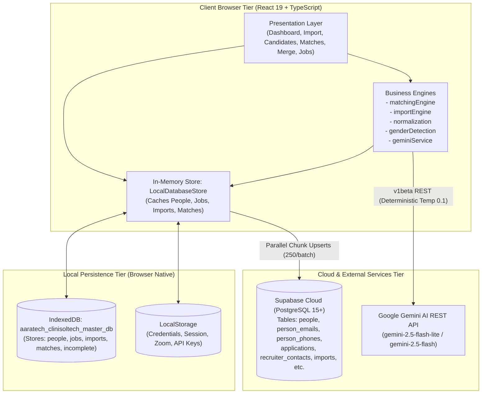
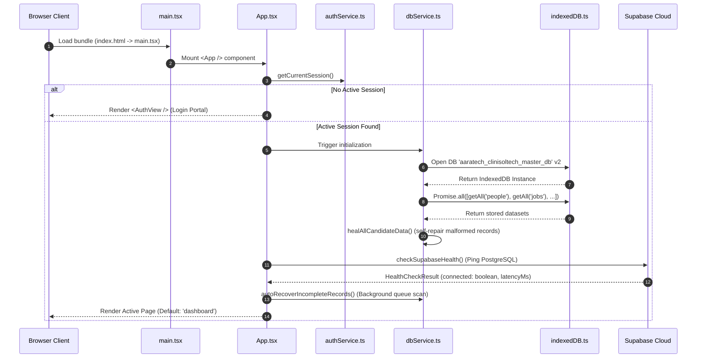
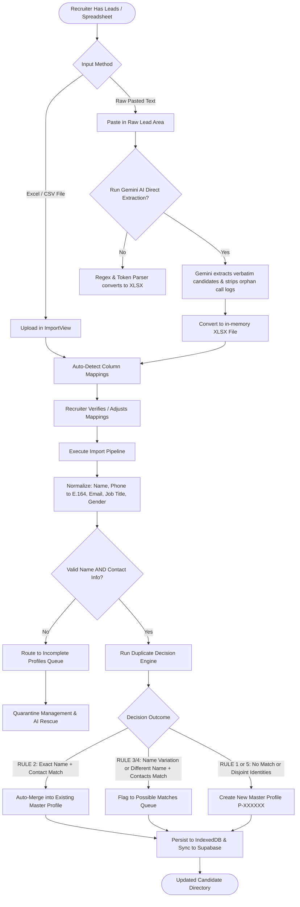
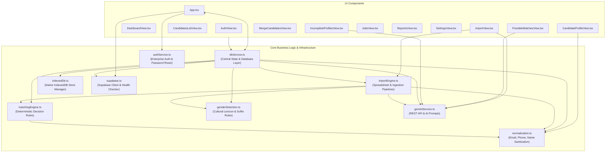
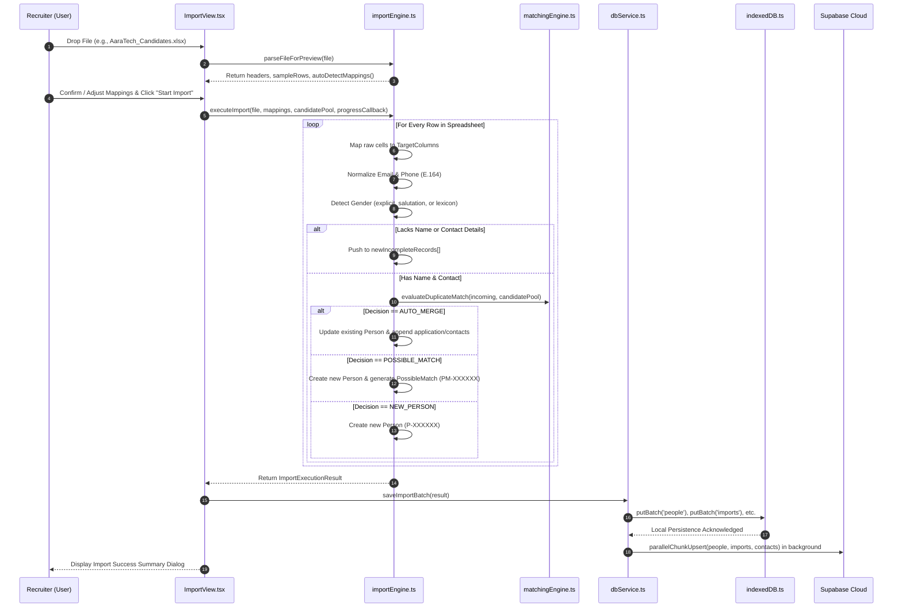
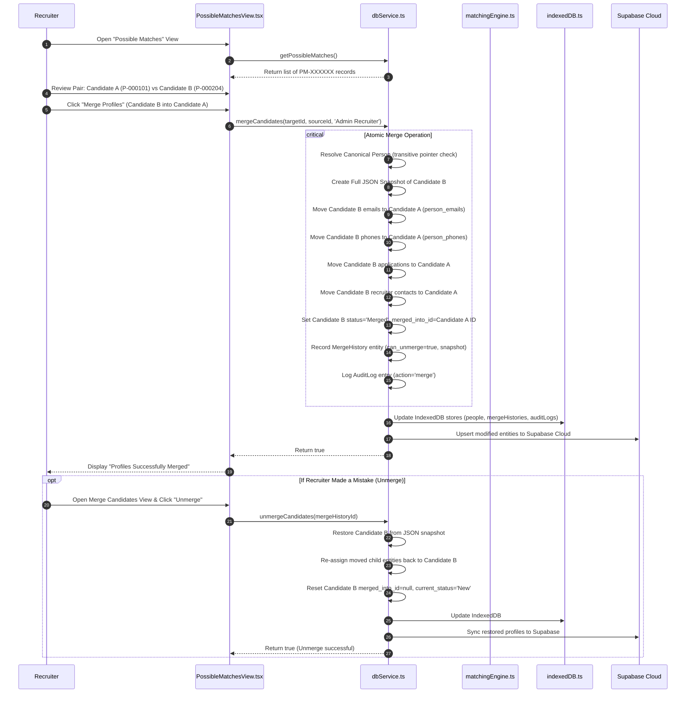

# System Architecture & Data Flow

**Repository:** Master Database for AaraTech & ClinisolTech  
**Specification Level:** Senior Enterprise Architect Audit  
**Architecture Style:** Client-Centric Single Page Application (SPA) with Dual Persistence (IndexedDB + Cloud PostgreSQL) & External GenAI Engine  

---

## 1. Architectural Overview & Component Tiers

The system is constructed as a modern, high-throughput recruitment application designed to ingest, normalize, deduplicate, and manage tens of thousands of candidate profiles across two sister staffing entities (**AaraTech** and **ClinisolTech**).

### 1.1 Architectural Tiers Breakdown

1. **Presentation Layer (React 19 + TailwindCSS v4):**
   - Composed of modular, stateful functional views: `DashboardView`, `ImportView`, `CandidatesListView`, `CandidateProfileView`, `PossibleMatchesView`, `MergeCandidatesView`, `IncompleteProfilesView`, `JobsView`, `ReportsView`, `GlobalSearchView`, and `SettingsView`.
   - Managed via top-level shell `App.tsx` and enterprise layout components (`Sidebar.tsx`, `Header.tsx`).

2. **In-Memory & Local Synchronization Layer (`src/lib/dbService.ts` & `src/lib/indexedDb.ts`):**
   - Implements `LocalDatabaseStore`, an in-memory cache holding arrays of all entities.
   - Transparently backed by **IndexedDB** (`aaratech_clinisoltech_master_db`, Version 2). Solves the browser 5MB `localStorage` limit by providing hundreds of megabytes of reliable local disk storage.
   - On browser boot, records are read from IndexedDB in parallel (`Promise.all`), self-healed, and loaded into memory within milliseconds.

3. **Cloud Synchronization Tier (`src/lib/supabase.ts`):**
   - Connects to Supabase Cloud PostgreSQL using `@supabase/supabase-js`.
   - Executes background parallel chunk upserts (`parallelChunkUpsert` in `dbService.ts` batches 250 records per chunk with a concurrency factor of 3).
   - Provides resilient offline-first behavior: if internet connectivity or Supabase credentials are unavailable, the application functions 100% locally on IndexedDB.

4. **External Artificial Intelligence Tier (`src/lib/geminiService.ts`):**
   - Direct client-to-API integration with Google Generative Language v1beta endpoint.
   - Uses zero-shot prompt engineering with temperature `0.1` and `responseMimeType: "application/json"`.
   - Features automated model fallback cascading from `gemini-2.5-flash-lite` to `gemini-2.5-flash` to `gemini-3.8-flash`.

---

## 2. Application Entry Points & Initialization Sequence

The application boot sequence follows a strict dependency lifecycle to guarantee data integrity before rendering views:

---

## 3. End-to-End Business Workflows

### 3.1 Business Workflow Diagram

---

## 4. Module Responsibilities & Dependency Map

---

## 5. Core Workflow Sequence Diagrams

### 5.1 File Ingestion & Import Pipeline Sequence

### 5.2 Duplicate Detection, Match Evaluation & Reversible Merge Sequence

---

## 6. Error Handling, Logging, and Data Safeguards

### 6.1 Data Integrity Safeguards
- **Zero Hallucination Constraint:** Ingestion algorithms use strict regex boundaries. At no point does the application generate fictitious names, fabricate phone area codes, or alter historical recruiter feedback.
- **Transitive Pointer Traversal (`resolveCanonicalPerson`):** When candidate C is merged into B, and B is subsequently merged into A, the system follows pointers recursively to map C directly to A, eliminating dangling merge pointers or orphaned child records.
- **Offline Fault Tolerance:** If Supabase is unreachable (e.g., bad network, invalid credentials, or CORS failure), API queries catch errors and gracefully degrade to local IndexedDB operations without crashing the frontend.

### 6.2 Error Logging
- Errors encountered during spreadsheet processing are captured per-row in `ImportExecutionResult.errorRows` (`{ row: number, reason: string, rawData: Record<string, any> }`).
- Recruiter feedback notes are stored verbatim in `recruiter_contacts.original_feedback` and are never modified or truncated during system processing.
