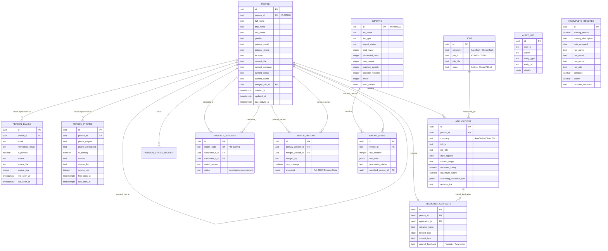

# Database & Data Model Specification

**Database Engine:** PostgreSQL 15+ (Hosted on Supabase Cloud) + Client-Side Native IndexedDB Object Stores  
**Extensions Required:** `uuid-ossp` (UUID generation), `pg_trgm` (Trigram fuzzy text search)  
**Schema Script Path:** [supabase/migrations/20261008000001_master_database_schema.sql](file:///c:/Users/yarla/OneDrive/Documents/Desktop/Master%20database%20for%20Aaratech%20&%20Clinisoltech/supabase/migrations/20261008000001_master_database_schema.sql)  

---

## 1. Entity-Relationship Diagram (ERD)

---

## 2. Field-Level Data Dictionary

*(All sample values below are synthetic and for architectural illustration only. No actual candidate data or secrets are included.)*

### 2.1 Table: `people` (Consolidated Master Candidate Profile)
- **Primary Key:** `id` (`UUID`)
- **Sequences:** `person_id_seq` formats `person_id` via `generate_person_id()` as `P-000001`.
- **Foreign Keys:** `merged_into_id` references `people(id) ON DELETE SET NULL`.

| Column Name | SQL Data Type | Nullable | Default | Constraints / Indexes | Description | Synthetic Sample Value |
| :--- | :--- | :---: | :--- | :--- | :--- | :--- |
| `id` | `UUID` | No | `gen_random_uuid()` | Primary Key | Internal system UUID | `a1b2c3d4-e5f6-7a8b-9c0d-1e2f3a4b5c6d` |
| `person_id` | `TEXT` | No | `generate_person_id()`| Unique, Indexed | Human-readable identifier | `P-000412` |
| `first_name` | `TEXT` | Yes | `NULL` | None | First name token | `Sandeep` |
| `last_name` | `TEXT` | Yes | `NULL` | None | Last name tokens | `Kumar` |
| `full_name` | `TEXT` | No | None | GIN Trigram, BTree | Canonical candidate name | `Sandeep Kumar` |
| `gender` | `TEXT` | Yes | `'Unspecified'` | None | Detected or assigned gender | `Male` |
| `primary_email` | `TEXT` | Yes | `NULL` | BTree Indexed | Primary active email | `sandeep.k@example.com` |
| `primary_phone` | `TEXT` | Yes | `NULL` | BTree Indexed | Primary active phone number | `2143349058` |
| `location` | `TEXT` | Yes | `NULL` | None | City / State / Country | `Dallas, Texas, United States` |
| `zip_code` | `TEXT` | Yes | `NULL` | None | Postal code | `75001` |
| `headline` | `TEXT` | Yes | `NULL` | None | Candidate headline / bio | `Senior Data Analyst (SQL, Python)` |
| `current_title` | `TEXT` | Yes | `NULL` | None | Current job role | `Data Analyst` |
| `current_company`| `TEXT` | Yes | `NULL` | None | Candidate or assigned company | `AaraTech` |
| `linkedin_url` | `TEXT` | Yes | `NULL` | BTree Indexed | Normalized profile URL | `linkedin.com/in/sandeep-k-sample` |
| `current_status`| `TEXT` | No | `'New'` | BTree Indexed | Operational recruiting status | `Assigned` |
| `current_owner` | `TEXT` | Yes | `'Unassigned'` | BTree Indexed | Assigned recruiter name | `Adam` |
| `merged_into_id`| `UUID` | Yes | `NULL` | FK -> `people(id)` | Pointer to primary master profile | `NULL` |
| `created_at` | `TIMESTAMPTZ` | No | `now()` | None | Record creation timestamp | `2026-01-15T08:30:00Z` |
| `updated_at` | `TIMESTAMPTZ` | No | `now()` | None | Profile last updated timestamp| `2026-10-14T11:20:00Z` |
| `last_activity_at`| `TIMESTAMPTZ`| No | `now()` | Descending Index | Date of latest candidate activity | `2026-10-14T11:20:00Z` |

---

### 2.2 Table: `person_emails` (Multiple Historical Emails)
- **Primary Key:** `id` (`UUID`)
- **Foreign Keys:** `person_id` references `people(id) ON DELETE CASCADE`.

| Column Name | SQL Data Type | Nullable | Default | Description | Synthetic Sample Value |
| :--- | :--- | :---: | :--- | :--- | :--- |
| `id` | `UUID` | No | `gen_random_uuid()` | Primary Key | `b2c3d4e5-f6a7-8b9c-0d1e-2f3a4b5c6d7e` |
| `person_id` | `UUID` | No | None | Parent Person UUID | `a1b2c3d4-e5f6-7a8b-9c0d-1e2f3a4b5c6d` |
| `email` | `TEXT` | No | None | Original verbatim email | `sandeep.k@example.com` |
| `normalized_email`| `TEXT` | No | None | Lowercase, whitespace-stripped | `sandeep.k@example.com` |
| `is_primary` | `BOOLEAN` | No | `false` | True if currently active | `true` |
| `source` | `TEXT` | Yes | `NULL` | Source channel or recruiter review | `file_import` |
| `source_file` | `TEXT` | Yes | `NULL` | Original spreadsheet filename | `Q1_Tech_Applicants.xlsx` |
| `source_row` | `INTEGER` | Yes | `NULL` | Spreadsheet row number | `42` |
| `first_seen_at` | `TIMESTAMPTZ` | No | `now()` | First timestamp recorded | `2025-01-10T09:00:00Z` |
| `last_seen_at` | `TIMESTAMPTZ` | No | `now()` | Most recent timestamp recorded | `2026-10-14T11:20:00Z` |
| `created_at` | `TIMESTAMPTZ` | No | `now()` | Entity creation timestamp | `2025-01-10T09:00:00Z` |

---

### 2.3 Table: `person_phones` (Multiple Historical Phones)
- **Primary Key:** `id` (`UUID`)
- **Foreign Keys:** `person_id` references `people(id) ON DELETE CASCADE`.

| Column Name | SQL Data Type | Nullable | Default | Description | Synthetic Sample Value |
| :--- | :--- | :---: | :--- | :--- | :--- |
| `id` | `UUID` | No | `gen_random_uuid()` | Primary Key | `c3d4e5f6-a7b8-9c0d-1e2f-3a4b5c6d7e8f` |
| `person_id` | `UUID` | No | None | Parent Person UUID | `a1b2c3d4-e5f6-7a8b-9c0d-1e2f3a4b5c6d` |
| `phone_original` | `TEXT` | No | None | Original unformatted phone | `+1 (214) 334-9058` |
| `phone_normalized`| `TEXT` | No | None | Digits-only standard (10-digit US) | `2143349058` |
| `is_primary` | `BOOLEAN` | No | `false` | True if currently active phone | `true` |
| `source` | `TEXT` | Yes | `NULL` | Originating source | `file_import` |
| `source_file` | `TEXT` | Yes | `NULL` | Spreadsheet filename | `Q1_Tech_Applicants.xlsx` |
| `source_row` | `INTEGER` | Yes | `NULL` | Row number | `42` |
| `first_seen_at` | `TIMESTAMPTZ` | No | `now()` | First recorded date | `2025-01-10T09:00:00Z` |
| `last_seen_at` | `TIMESTAMPTZ` | No | `now()` | Most recent date | `2026-10-14T11:20:00Z` |
| `created_at` | `TIMESTAMPTZ` | No | `now()` | Creation date | `2025-01-10T09:00:00Z` |

---

### 2.4 Table: `applications` (Historical Job Submissions)
- **Primary Key:** `id` (`UUID`)
- **Foreign Keys:** `person_id` references `people(id) ON DELETE CASCADE`.

| Column Name | SQL Data Type | Nullable | Default | Description | Synthetic Sample Value |
| :--- | :--- | :---: | :--- | :--- | :--- |
| `id` | `UUID` | No | `gen_random_uuid()` | Primary Key | `d4e5f6a7-b89c-0d1e-2f3a-4b5c6d7e8f9a` |
| `person_id` | `UUID` | No | None | Parent Candidate UUID | `a1b2c3d4-e5f6-7a8b-9c0d-1e2f3a4b5c6d` |
| `company` | `TEXT` | No | None | `'AaraTech'` or `'ClinisolTech'` | `AaraTech` |
| `job_id` | `TEXT` | Yes | `NULL` | Internal Requisition ID | `AT-002` |
| `job_title` | `TEXT` | No | None | Title of applied position | `Data Analyst` |
| `date_applied` | `DATE` | No | `CURRENT_DATE` | Submission date | `2025-01-21` |
| `current_stage` | `TEXT` | No | `'Applied'` | Application pipeline stage | `Applied` |
| `minimum_salary`| `NUMERIC` | Yes | `NULL` | Compensation minimum | `95000` |
| `maximum_salary`| `NUMERIC` | Yes | `NULL` | Compensation maximum | `110000` |
| `currency_code` | `TEXT` | Yes | `'USD'` | Currency denominator | `USD` |
| `screening_questions_raw`| `JSONB` | Yes | `'[]'::jsonb` | Unstructured Q&A responses | `[{"question": "Visa", "answer": "OPT"}]` |
| `resume_link` | `TEXT` | Yes | `NULL` | URL to resume file | `https://drive.google.com/file/d/sample-resume` |
| `source_import_id`| `TEXT` | Yes | `NULL` | Linked Import ID | `IMP-000042` |

---

### 2.5 Table: `recruiter_contacts` (Verbatim Feedback Log)
- **Primary Key:** `id` (`UUID`)
- **Foreign Keys:** `person_id` references `people(id) ON DELETE CASCADE`, `application_id` references `applications(id) ON DELETE SET NULL`.

| Column Name | SQL Data Type | Nullable | Default | Description | Synthetic Sample Value |
| :--- | :--- | :---: | :--- | :--- | :--- |
| `id` | `UUID` | No | `gen_random_uuid()` | Primary Key | `e5f6a7b8-9c0d-1e2f-3a4b-5c6d7e8f9a0b` |
| `person_id` | `UUID` | No | None | Parent Candidate UUID | `a1b2c3d4-e5f6-7a8b-9c0d-1e2f3a4b5c6d` |
| `application_id`| `UUID` | Yes | `NULL` | Optional linked application | `d4e5f6a7-b89c-0d1e-2f3a-4b5c6d7e8f9a` |
| `recruiter_name`| `TEXT` | No | None | Recruiter who logged feedback | `Adam` |
| `contact_date` | `DATE` | No | `CURRENT_DATE` | Date of touchpoint | `2025-01-21` |
| `contact_type` | `TEXT` | No | `'Phone'` | Touchpoint channel | `Phone` |
| `original_feedback`| `TEXT` | No | None | **Verbatim verbatim note** | `4+/Masters 2024/OPT EAD/TX/Relocate/Python/Looking for 95k` |

---

### 2.6 Table: `jobs` (Requisition Definitions)
- **Primary Key:** `id` (`UUID`)

| Column Name | SQL Data Type | Nullable | Default | Description | Synthetic Sample Value |
| :--- | :--- | :---: | :--- | :--- | :--- |
| `id` | `UUID` | No | `gen_random_uuid()` | Primary Key | `11111111-0000-4000-a000-000000000002` |
| `company` | `TEXT` | No | None | Requisition Entity | `AaraTech` |
| `job_id` | `TEXT` | No | None | Job Code | `AT-002` |
| `job_title` | `TEXT` | No | None | Position Title | `Data Analyst` |
| `job_url` | `TEXT` | Yes | `NULL` | Career portal URL | `https://aaratech.com/careers/data-analyst` |
| `status` | `TEXT` | No | `'Active'` | State (`Active`, `Closed`, `Draft`)| `Active` |

---

### 2.7 Table: `possible_matches` (Duplicate Review Queue)
- **Primary Key:** `id` (`UUID`)
- **Sequences:** `match_code_seq` formats `match_code` via `generate_match_code()` as `PM-000001`.
- **Foreign Keys:** `candidate_a_id` and `candidate_b_id` reference `people(id) ON DELETE CASCADE`.

| Column Name | SQL Data Type | Nullable | Default | Description | Synthetic Sample Value |
| :--- | :--- | :---: | :--- | :--- | :--- |
| `id` | `UUID` | No | `gen_random_uuid()` | Primary Key | `f6a7b89c-0d1e-2f3a-4b5c-6d7e8f9a0b1c` |
| `match_code` | `TEXT` | No | `generate_match_code()`| Unique Match Code | `PM-000042` |
| `candidate_a_id`| `UUID` | No | None | Candidate A reference | `a1b2c3d4-e5f6-7a8b-9c0d-1e2f3a4b5c6d` |
| `candidate_b_id`| `UUID` | No | None | Candidate B reference | `a9b8c7d6-e5f4-3a2b-1c0d-9e8f7a6b5c4d` |
| `match_reason` | `TEXT` | No | None | Triggered rule rationale | `Name variation detected ("Sai depu" vs "Sai D"), but phone & email match.` |
| `status` | `TEXT` | No | `'pending'` | Review state (`pending`, `merged`, `rejected`, `reviewed_later`) | `pending` |
| `reviewed_by` | `TEXT` | Yes | `NULL` | Operator who resolved match | `Admin Recruiter` |
| `reviewed_at` | `TIMESTAMPTZ` | Yes | `NULL` | Timestamp of review | `2026-10-14T14:30:00Z` |

---

### 2.8 Table: `merge_history` (Audit & Unmerge State)
- **Primary Key:** `id` (`UUID`)
- **Foreign Keys:** `primary_person_id` and `merged_person_id` reference `people(id) ON DELETE CASCADE`.

| Column Name | SQL Data Type | Nullable | Default | Description | Synthetic Sample Value |
| :--- | :--- | :---: | :--- | :--- | :--- |
| `id` | `UUID` | No | `gen_random_uuid()` | Primary Key | `0a1b2c3d-4e5f-6a7b-8c9d-0e1f2a3b4c5d` |
| `primary_person_id`| `UUID` | No | None | Surviving profile UUID | `a1b2c3d4-e5f6-7a8b-9c0d-1e2f3a4b5c6d` |
| `merged_person_id` | `UUID` | No | None | Merged secondary profile UUID | `a9b8c7d6-e5f4-3a2b-1c0d-9e8f7a6b5c4d` |
| `merged_by` | `TEXT` | No | `'Admin'` | Recruiter username | `Admin Recruiter` |
| `merged_at` | `TIMESTAMPTZ` | No | `now()` | Merge timestamp | `2026-10-14T15:00:00Z` |
| `can_unmerge` | `BOOLEAN` | No | `true` | True if reversible | `true` |
| `unmerged_at` | `TIMESTAMPTZ` | Yes | `NULL` | Populated if unmerged | `NULL` |
| `snapshot` | `JSONB` | No | `'{}'::jsonb` | Complete pre-merge state snapshot | `{"id": "...", "full_name": "...", "emails": [...]}` |

---

### 2.9 Table: `incomplete_records` (Quarantine Leads Queue)
- **Primary Key:** `id` (`UUID`)

| Column Name | SQL Data Type | Nullable | Default | Description | Synthetic Sample Value |
| :--- | :--- | :---: | :--- | :--- | :--- |
| `id` | `UUID` | No | `gen_random_uuid()` | Primary Key | `1a2b3c4d-5e6f-7a8b-9c0d-1e2f3a4b5c6d` |
| `missing_reason`| `VARCHAR(50)` | No | None | Quarantine category | `missing_phone` |
| `missing_description`| `TEXT` | No | None | Human explanation | `Candidate lacks verified telephone number` |
| `date_assigned` | `DATE` | No | `CURRENT_DATE` | Ingestion date | `2025-04-24` |
| `raw_name` | `TEXT` | Yes | `NULL` | Raw unparsed name | `aditi sangle` |
| `raw_email` | `TEXT` | Yes | `NULL` | Raw unparsed email | `aditisangle2@gmail.com` |
| `raw_phone` | `TEXT` | Yes | `NULL` | Raw phone text | `NULL` |
| `raw_role` | `TEXT` | Yes | `NULL` | Role or technology token | `DA` |
| `company` | `VARCHAR(100)`| No | `'AaraTech'` | Associated entity | `AaraTech` |
| `owner` | `VARCHAR(100)`| No | `'Unassigned'` | Assigned recruiter | `Alex` |
| `recruiter_feedback`| `TEXT` | Yes | `NULL` | Verbatim remarks | `Female/Not Interested` |

---

### 2.10 Table: `imports` (File Ingestion Batch Records)
- **Primary Key:** `id` (`TEXT`, e.g. `'IMP-000042'`)
- **Sequences:** `import_id_seq` formats `id` via `generate_import_id()` as `IMP-000001`.

| Column Name | SQL Data Type | Nullable | Default | Description | Synthetic Sample Value |
| :--- | :--- | :---: | :--- | :--- | :--- |
| `id` | `TEXT` | No | None | Human-readable Import ID | `IMP-000042` |
| `file_name` | `TEXT` | No | None | Name of uploaded spreadsheet | `Q1_AaraTech_Leads.xlsx` |
| `file_type` | `TEXT` | No | None | Extension (`xlsx`, `xls`, `csv`) | `xlsx` |
| `import_status` | `TEXT` | No | `'processing'` | Batch state (`processing`, `completed`, `failed`) | `completed` |
| `total_rows` | `INTEGER` | No | `0` | Total rows detected in file | `450` |
| `processed_rows` | `INTEGER` | No | `0` | Rows successfully evaluated | `450` |
| `new_people` | `INTEGER` | No | `0` | New candidate master profiles created | `380` |
| `matched_people` | `INTEGER` | No | `0` | Existing profiles matched & updated | `55` |
| `possible_matches`| `INTEGER` | No | `0` | Ambiguous pairs flagged for review | `10` |
| `applications_created`| `INTEGER`| No | `0` | Application history rows inserted | `435` |
| `contacts_created`| `INTEGER` | No | `0` | Verbatim touchpoint notes inserted | `435` |
| `errors` | `INTEGER` | No | `0` | Count of rejected malformed rows | `5` |
| `error_details` | `JSONB` | Yes | `'[]'::jsonb` | Array of row-level error reasons | `[{"row": 12, "reason": "No name"}]` |
| `uploaded_by` | `TEXT` | No | `'Admin'` | Recruiter or marketer username | `Digital Marketing Team` |
| `started_at` | `TIMESTAMPTZ` | No | `now()` | Ingestion start timestamp | `2026-10-14T09:00:00Z` |
| `completed_at` | `TIMESTAMPTZ` | Yes | `NULL` | Ingestion completion timestamp | `2026-10-14T09:00:08Z` |
| `created_at` | `TIMESTAMPTZ` | No | `now()` | Entity creation timestamp | `2026-10-14T09:00:00Z` |

---

### 2.11 Table: `import_rows` (Granular Row Ingestion Traceability)
- **Primary Key:** `id` (`UUID`)
- **Foreign Keys:** `import_id` references `imports(id) ON DELETE CASCADE`, `matched_person_id` references `people(id) ON DELETE SET NULL`.

| Column Name | SQL Data Type | Nullable | Default | Description | Synthetic Sample Value |
| :--- | :--- | :---: | :--- | :--- | :--- |
| `id` | `UUID` | No | `gen_random_uuid()` | Primary Key | `2b3c4d5e-6f7a-8b9c-0d1e-2f3a4b5c6d7e` |
| `import_id` | `TEXT` | No | None | Parent Import ID | `IMP-000042` |
| `row_number` | `INTEGER` | No | None | 1-indexed row number in spreadsheet | `15` |
| `raw_data` | `JSONB` | No | None | Raw unmodified cell values object | `{"Candidate Name": "John Doe", "Phone": "214..."}` |
| `processing_status`| `TEXT` | No | `'success'` | Outcome (`success`, `matched`, `possible_match`, `error`, `skipped`) | `matched` |
| `matched_person_id`| `UUID` | Yes | `NULL` | Assigned Person UUID | `a1b2c3d4-e5f6-7a8b-9c0d-1e2f3a4b5c6d` |
| `match_type` | `TEXT` | Yes | `NULL` | Auto-merge rule triggered | `RULE_EXACT_NAME_EMAIL_MATCH` |
| `error_message` | `TEXT` | Yes | `NULL` | Error details if row failed | `NULL` |
| `created_at` | `TIMESTAMPTZ` | No | `now()` | Trace record timestamp | `2026-10-14T09:00:02Z` |

---

### 2.12 Table: `person_status_history` (Recruitment Lifecycle State Changes)
- **Primary Key:** `id` (`UUID`)
- **Foreign Keys:** `person_id` references `people(id) ON DELETE CASCADE`.

| Column Name | SQL Data Type | Nullable | Default | Description | Synthetic Sample Value |
| :--- | :--- | :---: | :--- | :--- | :--- |
| `id` | `UUID` | No | `gen_random_uuid()` | Primary Key | `3c4d5e6f-7a8b-9c0d-1e2f-3a4b5c6d7e8f` |
| `person_id` | `UUID` | No | None | Candidate UUID | `a1b2c3d4-e5f6-7a8b-9c0d-1e2f3a4b5c6d` |
| `old_status` | `TEXT` | Yes | `NULL` | Previous operational status | `'New'` |
| `new_status` | `TEXT` | No | None | Updated operational status | `'Assigned'` |
| `changed_by` | `TEXT` | No | None | Recruiter username or automation | `'Adam'` |
| `reason` | `TEXT` | Yes | `NULL` | Justification note | `'Candidate assigned for screening call'` |
| `created_at` | `TIMESTAMPTZ` | No | `now()` | State transition timestamp | `2026-10-14T10:15:00Z` |

---

### 2.13 Table: `audit_log` (Administrative Action Provenance)
- **Primary Key:** `id` (`UUID`)

| Column Name | SQL Data Type | Nullable | Default | Description | Synthetic Sample Value |
| :--- | :--- | :---: | :--- | :--- | :--- |
| `id` | `UUID` | No | `gen_random_uuid()` | Primary Key | `4d5e6f7a-8b9c-0d1e-2f3a-4b5c6d7e8f9a` |
| `user_id` | `TEXT` | No | `'Admin'` | Username or operator session ID | `'usr-mkt-team'` |
| `action` | `TEXT` | No | None | Action (`import`, `merge`, `unmerge`, `status_change`, `owner_change`, `profile_edit`, `delete_archive`) | `'merge'` |
| `entity_type` | `TEXT` | No | None | Target entity (`person`, `application`, `recruiter_contact`, `import`) | `'person'` |
| `entity_id` | `TEXT` | No | None | UUID or code of affected entity | `'a1b2c3d4-e5f6-7a8b-9c0d-1e2f3a4b5c6d'` |
| `details` | `JSONB` | Yes | `NULL` | Action payload metadata | `{"mergedPersonId": "...", "mergedName": "..."}` |
| `created_at` | `TIMESTAMPTZ` | No | `now()` | Immutable event timestamp | `2026-10-14T15:00:00Z` |

---

## 3. Database Indexes for High-Throughput Performance

To ensure real-time searching across 20,000–50,000+ candidate rows, PostgreSQL indexes are defined in `20261008000001_master_database_schema.sql`:

1. `idx_people_full_name_trgm`: PostgreSQL GIN Trigram index (`USING gin(full_name gin_trgm_ops)`) enabling sub-millisecond typo-tolerant fuzzy matching across names.
2. `idx_people_person_id`: BTree index on human-readable ID (`P-000123`).
3. `idx_people_primary_email` & `idx_people_primary_phone`: BTree lookup indexes.
4. `idx_emails_normalized` on `person_emails(normalized_email)`: Index for instantaneous duplicate email detection.
5. `idx_phones_normalized` on `person_phones(phone_normalized)`: Index for instantaneous duplicate phone detection.
6. `idx_people_last_activity_at`: Descending index for fast dashboard feed sorting.
7. `idx_possible_matches_candidates` on `possible_matches(candidate_a_id, candidate_b_id)`: Multi-column index for fast duplicate pair lookups.

---

## 4. Schema Discrepancy & Consistency Audit

During the code audit, a concrete schema divergence was identified between the migration files:

- **Canonical Migration File:** [supabase/migrations/20261008000001_master_database_schema.sql](file:///c:/Users/yarla/OneDrive/Documents/Desktop/Master%20database%20for%20Aaratech%20&%20Clinisoltech/supabase/migrations/20261008000001_master_database_schema.sql#L337-L360) contains the complete `incomplete_records` DDL with table creation, indexes, and RLS policies.
- **Settings Screen Constant:** [src/lib/migrationSql.ts](file:///c:/Users/yarla/OneDrive/Documents/Desktop/Master%20database%20for%20Aaratech%20&%20Clinisoltech/src/lib/migrationSql.ts) contains `MASTER_SCHEMA_SQL` which ends at line 328, omitting the `incomplete_records` table entirely.
- **Risk:** If a DBA copies SQL from the application Settings screen into the Supabase SQL Editor rather than using the repository migration file, the `incomplete_records` table will not be created, causing all incomplete lead syncs to fail with PostgreSQL error `42P01 (relation "incomplete_records" does not exist)`.
