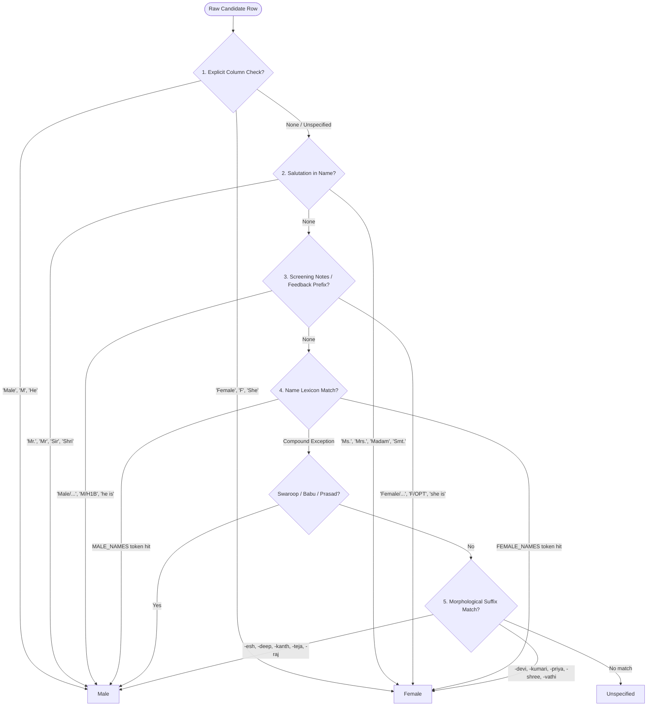

# Business Logic & Core Algorithms

**Repository:** Master Database for AaraTech & ClinisolTech  
**Specification Level:** Senior Systems Architect & Algorithm Audit  

---

## 1. Duplicate Matching & Decision Engine

The duplicate matching algorithm governs how new leads, spreadsheet rows, and existing profiles are compared and consolidated.

- **Primary Source File:** [src/lib/matchingEngine.ts](file:///c:/Users/yarla/OneDrive/Documents/Desktop/Master%20database%20for%20Aaratech%20&%20Clinisoltech/src/lib/matchingEngine.ts)
- **Primary Function:** `evaluateCandidatePair(candidateA: Person, candidateB: Person, options?: any): DuplicateDecisionResult`

### 1.1 Decision Matrix & Execution Order

The evaluation order is deterministic. Rules are evaluated sequentially; the first rule whose conditions are satisfied dictates the decision outcome:

| Evaluation Order | Rule Identifier | Name Match Status | Email Match Status | Phone Match Status | Decision Outcome | Confidence | Rationale / System Action |
| :---: | :--- | :---: | :---: | :---: | :---: | :---: | :--- |
| **0** | `RULE_COMPANY_ISOLATION_BLOCKED` | Any | Any | Any | `NO_MATCH` | `0.0` | **Cross-Company Isolation:** If Candidate A is AaraTech and Candidate B is ClinisolTech, comparison terminates immediately. Merging across companies is strictly prohibited. |
| **0b**| `RULE_SELF_PROFILE` | Any | Any | Any | `NO_MATCH` | `0.0` | Same profile UUID evaluated against itself. |
| **0c**| `BLOCKED_PREVIOUSLY_SEPARATED` | Any | Any | Any | `MANUAL_REVIEW` | `0.0` | Recruiter previously marked pair as "Not The Same Person". Auto-merge is permanently blocked. |
| **0d**| `BLOCKED_PREVIOUSLY_UNMERGED` | Any | Any | Any | `MANUAL_REVIEW` | `0.0` | Profiles were previously unmerged. Auto-merge blocked; manual confirmation required. |
| **1** | `RULE_EXACT_NAME_EMAIL_PHONE_MATCH` | `Exact` | `Match` | `Match` | `AUTO_MERGE` | `1.0` | **Rule 2 Variant:** Exact normalized name and verified matching Email AND Phone. Consolidated into 1 master profile. |
| **2** | `RULE_EXACT_NAME_EMAIL_MATCH` | `Exact` | `Match` | Different / Missing | `AUTO_MERGE` | `0.96` | **Rule 2:** Exact normalized name and matching verified Email. Consolidated into 1 master profile. |
| **3** | `RULE_EXACT_NAME_PHONE_MATCH` | `Exact` | Different / Missing | `Match` | `AUTO_MERGE` | `0.96` | **Rule 2:** Exact normalized name and matching verified Phone number. Consolidated into 1 master profile. |
| **4** | `RULE_SAME_NAME_DIFF_CONTACTS_DISTINCT_PROFILES` | `Exact` or `Similar` | Different / Missing | Different / Missing | `NO_MATCH` | `0.0` | **Rule 1:** Name matches, but both phone and email are different (zero contact overlap). Treated as two distinct people sharing a common name (e.g. two individuals named "Sandeep G"). |
| **5** | `RULE_SIMILAR_NAME_BOTH_CONTACTS_MANUAL_REVIEW` | `Similar` | `Match` | `Match` | `MANUAL_REVIEW` | `0.88` | **Rule 4:** Name variations/initials (e.g., "Sai depu" vs "Sai D", "Ravi K" vs "Ravi Kumar"), but both Phone and Email match. Flagged to Possible Matches queue for human verification. |
| **6** | `RULE_DIFF_NAME_BOTH_CONTACTS_MANUAL_REVIEW` | `Different` | `Match` | `Match` | `MANUAL_REVIEW` | `0.82` | **Rule 3:** Candidate names are completely different (e.g. "Siva Pavan Kumar C" vs "Pavan Chowdary"), but both Email and Phone match. Flagged for human review; never auto-merged. |
| **7** | `RULE_SIMILAR_NAME_SINGLE_CONTACT_MATCH` | `Similar` | 1 Match | 1 Diff / Missing | `MANUAL_REVIEW` | `0.75` | Similar name with a single matching contact point. Flagged for manual review. |
| **8** | `RULE_NO_MATCH` | Different | 0 or 1 Match | 0 or 1 Match | `NO_MATCH` | `0.0` | No reliable duplicate evidence. Preserved as independent candidates. |

---

## 2. Name Comparison & Token Analysis Algorithm

- **Source File:** [src/lib/matchingEngine.ts](file:///c:/Users/yarla/OneDrive/Documents/Desktop/Master%20database%20for%20Aaratech%20&%20Clinisoltech/src/lib/matchingEngine.ts#L53-L177)
- **Functions:** `normalizeCandidateName()`, `calculateStringSimilarity()`, `compareCandidateNames()`

### 2.1 Normalization Pipeline
1. **Unicode De-accenting:** Normalizes with Unicode Form NFKD and strips non-spacing combining marks (`[\u0300-\u036f]`).
2. **Case Folding:** Converts to lowercase.
3. **Punctuation Removal:** Strips periods, apostrophes, and accents (`[.'’`]+`).
4. **Whitespace Compaction:** Collapses multiple spaces, tabs, and newlines into a single space.

### 2.2 Token Matching & Formatting Equivalence
1. **Joined vs. Separated Names:** The compact strings (spaces and dashes stripped) are compared. If `compactA === compactB`, the status is `'Exact'`.
   - Examples: `"SaiVenkat"` === `"Sai Venkat"`, `"MADHU"` === `"Madhu"`, `"UdayKiran"` === `"Uday Kiran"`.
2. **Initial & Abbreviation Detection:**
   - Evaluates whether the last name of one token is an initial of the other (e.g. `"Ravi K"` vs `"Ravi Kumar"` -> `'Similar'`).
   - Evaluates middle name initials (e.g. `"Sai Deepu Reddy"` vs `"Sai D Reddy"` -> `'Similar'`).
   - Evaluates 2-token vs 3-token compounds (e.g. `"Sai Deepu"` vs `"Sai Deepu Reddy"` -> `'Similar'`).
3. **Levenshtein Distance Scoring:**
   - If similarity score $\ge 0.82$, classified as `'Similar'`.
   - If similarity score $< 0.82$, classified as `'Different'`.

---

## 3. Contact Normalization & Auto-Healing Logic

- **Source File:** [src/lib/normalization.ts](file:///c:/Users/yarla/OneDrive/Documents/Desktop/Master%20database%20for%20Aaratech%20&%20Clinisoltech/src/lib/normalization.ts)
- **Functions:** `normalizeEmail()`, `normalizePhone()`, `normalizeLinkedInUrl()`

### 3.1 Email Normalization & Auto-Healing Pipeline
Recruiters frequently paste malformed emails from ATS spreadsheets. The normalization engine auto-repairs common formatting defects:
1. **Markdown Stripping:** Extracts emails embedded in markdown links (e.g., `[user@domain.com](mailto:user@domain.com)`).
2. **Invisible Whitespace Purging:** Removes zero-width spaces (`\u200B-\u200D`), byte-order marks (`\uFEFF`), and newline escapes.
3. **Regional Domain Healing:** Auto-heals `@yahoocouk` -> `@yahoo.co.uk`.
4. **Missing Dot Healing:** Detects omission of the dot preceding common TLDs:
   - `/@(gmail|outlook|yahoo|hotmail|icloud|aol|proton|rediffmail|live|msn)(com|org|net|in|co|edu)$/i` -> `@$1.$2`.
   - Examples: `sandeep@gmailcom` -> `sandeep@gmail.com`, `user@yahoocom` -> `user@yahoo.com`.
5. **Truncated TLD Repair:**
   - Auto-heals `@gmailco` -> `@gmail.com`, `@gmailc` -> `@gmail.com`.
6. **Strict Validation Regex:**
   - Must conform to `/^[a-zA-Z0-9._%+-]+@[a-zA-Z0-9.-]+\.[a-zA-Z]{2,}$/`. Returns `null` if invalid.

### 3.2 Phone Normalization Pipeline
1. **Placeholder Rejection:** Rejects literal entries like `"No Number"`, `"None"`, `"N/A"`, `"-"`.
2. **US Standard (10 Digits):** Extracts raw digits. If 11 digits starting with `1` (e.g. `12143349058` or `+1 214-334-9058`), strips leading `1` to produce normalized 10-digit format (`2143349058`).
3. **International Sequences:** If prepended with `+` and contains 8–15 digits, preserves the full international dialing sequence.

---

## 4. Cultural & Heuristic Gender Detection Engine

- **Source File:** [src/lib/genderDetection.ts](file:///c:/Users/yarla/OneDrive/Documents/Desktop/Master%20database%20for%20Aaratech%20&%20Clinisoltech/src/lib/genderDetection.ts)
- **Function:** `detectGender()`

### 4.1 Tiered Execution Order

### 4.2 Suffix Heuristics Matrix
- **Male Suffixes:** `-esh` (Ramesh, Suresh, Rajesh), `-ender` (Narender), `-deep` (Sandeep), `-kanth` (Srikanth), `-nath`, `-nadh`, `-sekhar`, `-teja`, `-babu`, `-singh`, `-raj`.
- **Female Suffixes:** `-devi`, `-kumari`, `-priya`, `-shree`, `-sree`, `-vathi`, `-wati`, `-latha`, `-amrutha`, `-deepika`, `-mounika`, `-harika`, `-swathi`, `-keerthi`, `-lavanya`, `-bhavani`, `-anusha`.

---

## 5. Job Title & Candidate Name Sanitization

- **Source File:** [src/lib/normalization.ts](file:///c:/Users/yarla/OneDrive/Documents/Desktop/Master%20database%20for%20Aaratech%20&%20Clinisoltech/src/lib/normalization.ts#L298-L386)

### 5.1 `cleanJobTitle(role, defaultRole)`
In recruiter spreadsheets, columns often shift, placing screening remarks or emails into the job title column. `cleanJobTitle` guards against this:
1. **Email Rejection:** If string contains `@` or matches email domain patterns, defaults to `'Data Analyst'`.
2. **Recruiter Name Rejection:** If string is `'Adam'`, `'Alex'`, or `'Unassigned'`, converts to `'General Sourced Candidate'`.
3. **Phone Number Rejection:** If string contains a phone number, defaults to `'Data Analyst'`.
4. **Screening Notes Rejection:** If string exceeds 40 characters or starts with visa terms (`"OPT"`, `"H1B"`, `"he is"`, `"4 years"`), defaults to `'Data Analyst'`.

### 5.2 `extractCandidateNameFromEmail(email)`
When a lead arrives without a candidate name but has a personal email handle, this function recovers the human name:
- `bharadwaj.tadepalli@example.com` -> `"Bharadwaj Tadepalli"`
- `alluchaitanya54@example.com` -> `"Allu Chaitanya"`
- `ankur1998sharma@example.com` -> `"Ankur Sharma"`
- `hpatel@example.com` -> `"H Patel"`
