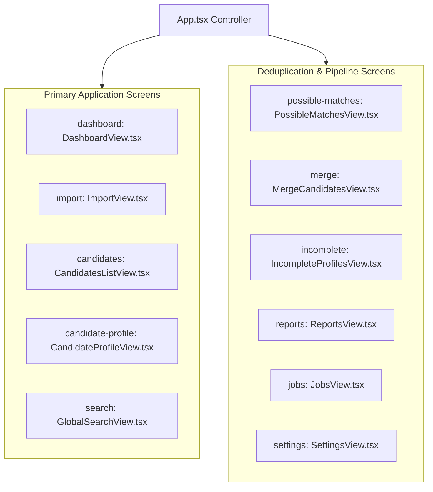

# Frontend Architecture & User Experience (UX)

**Repository:** Master Database for AaraTech & ClinisolTech  
**Design System:** Dark Navy Enterprise Navigation, Slate Neutral Surfaces, TailwindCSS v4, Lucide React Iconography  
**Aesthetic Standard:** Modern High-Density Enterprise Recruiting CRM with Real-Time Feedback and Table Zoom Controls  

---

## 1. Page & Route Catalog

The application uses client-side state routing managed by the `activePage` state inside [src/App.tsx](file:///c:/Users/yarla/OneDrive/Documents/Desktop/Master%20database%20for%20Aaratech%20&%20Clinisoltech/src/App.tsx).

---

## 2. Comprehensive View Specifications

### 2.1 View: `AuthView.tsx` (Enterprise Login & Access Portal)
- **Component File:** [src/components/auth/AuthView.tsx](file:///c:/Users/yarla/OneDrive/Documents/Desktop/Master%20database%20for%20Aaratech%20&%20Clinisoltech/src/components/auth/AuthView.tsx)
- **Modes:** `'login'`, `'forgot_password'`, `'reset_password'`.
- **Form Controls & Inputs:**
  - Email Address (`type="email"`, required).
  - Password / New Password / Confirm Password (`type="password"`, minimum 6 characters).
- **Quick-Login Pills (One-Click Testing for Staff):**
  - "Marketing Team (Full Admin)": Logs in `marketing@aaratech.com`.
  - "Digital Marketing Lead": Logs in `digitalmarketing@aaratech.com`.
  - "AaraTech Admin": Logs in `admin@aaratech.com`.
  - "ClinisolTech Admin": Logs in `marketing@clinisoltech.com`.
- **Feedback & Validation States:**
  - Red error callout for invalid credentials.
  - Emerald green success banner for simulated/live password reset links.

---

### 2.2 View: `DashboardView.tsx` (Executive Recruiting Intelligence)
- **Component File:** [src/components/dashboard/DashboardView.tsx](file:///c:/Users/yarla/OneDrive/Documents/Desktop/Master%20database%20for%20Aaratech%20&%20Clinisoltech/src/components/dashboard/DashboardView.tsx)
- **Top Company Switcher Banner:**
  - Pill buttons: "All Companies (Unified)", "AaraTech IT", "ClinisolTech Clinical".
  - Dynamically recalculates all statistical cards based on the selected company scope.
- **KPI Summary Grid (4 Metrics Cards):**
  1. *Total Consolidated People:* Master candidate profiles count (`dbService.getDashboardStats()`).
  2. *Job Applications Tracked:* Historical job submissions.
  3. *Verbatim Contact Touchpoints:* Call logs and screening feedback notes.
  4. *Pending Duplicate Reviews:* Count of possible matches requiring attention.
- **Charts & Operational Metrics:**
  - *Candidate Pipeline by Company:* Visual distribution bar comparing AaraTech vs ClinisolTech candidate volume.
  - *Operational Status Breakdown:* Horizontal progress bars showing volume for `New`, `Assigned`, `Contacted`, `Review`, `Closed`.
  - *Gender Distribution:* Visual breakdown of Male, Female, and Unspecified talent pool.
- **Recent Ingestion & Quick Activity Feed:**
  - Displays last 5 spreadsheet imports with row count, processed count, and timestamp.
  - Displays last 5 active candidates with direct click-through navigation to candidate profiles.

---

### 2.3 View: `CandidatesListView.tsx` (Master Data Table)
- **Component File:** [src/components/candidates/CandidatesListView.tsx](file:///c:/Users/yarla/OneDrive/Documents/Desktop/Master%20database%20for%20Aaratech%20&%20Clinisoltech/src/components/candidates/CandidatesListView.tsx)
- **Table Density & Table Zoom Control:**
  - Persisted Zoom slider & buttons: `75%`, `85%`, `95%` (default), `100%`, `110%`.
  - Stored in `localStorage.getItem('aat_table_zoom')`. Ensures all 12 table columns fit comfortably without horizontal scroll.
- **Filter Controls (9 Multi-Dimensional Filters):**
  1. *Search Bar:* Debounced instant text search across name, email, phone, location, Person ID.
  2. *Company Filter:* Dropdown (`All`, `AaraTech`, `ClinisolTech`).
  3. *Status Filter:* Dropdown (`All`, `New`, `Assigned`, `Contacted`, `Review`, `Not Interested`, `Closed`, `Dead`).
  4. *Assigned Owner:* Dropdown (`All`, `Adam`, `Alex`, `Unassigned`).
  5. *Gender Filter:* Dropdown (`All`, `Male`, `Female`, `Unspecified`).
  6. *Contact Completeness:* Dropdown (`All Candidates`, `Missing Phone Only`, `Missing Email Only`).
  7. *Resume Only Checkbox:* Toggles candidates with Google Drive resume links.
  8. *LinkedIn Only Checkbox:* Toggles candidates with LinkedIn URLs.
  9. *Date Assigned Range:* Presets (`All Time`, `Today`, `Last 7 Days`, `Last 30 Days`, `Custom Range`).
- **Interactive Table Columns (12 Fields):**
  - Checkbox (Bulk selection).
  - Person ID (`P-000123`).
  - Candidate Full Name (with link to profile).
  - Gender Badge (Interactive inline dropdown to switch Male/Female/Unspecified).
  - Primary Contact Email (Clickable `mailto:`).
  - Primary Contact Phone (Clickable `tel:`).
  - Current Title / Headline.
  - Assigned Company (`AaraTech` blue badge / `ClinisolTech` indigo badge).
  - Current Status (Interactive inline dropdown to update status).
  - Assigned Owner (Clickable pill opening Quick Assign Modal).
  - Date Applied / Assigned.
  - Actions (`View Profile` button).
- **Bulk Action Floating Toolbar:**
  - Appears automatically when 1 or more candidates are checked.
  - Actions: *Bulk Assign Owner*, *Bulk Update Status*, *Bulk Update Gender*, *Bulk Auto-Detect Gender*, *Bulk Export to Excel*, *Bulk Delete/Archive*.

---

### 2.4 View: `CandidateProfileView.tsx` (360-Degree Profile View)
- **Component File:** [src/components/candidates/CandidateProfileView.tsx](file:///c:/Users/yarla/OneDrive/Documents/Desktop/Master%20database%20for%20Aaratech%20&%20Clinisoltech/src/components/candidates/CandidateProfileView.tsx)
- **Header Summary Card:**
  - Human-readable ID (`P-000412`), Full Name, Headline, Location, Current Company, Assigned Owner.
  - Action buttons: `Edit Profile`, `Update Status`, `Assign Owner`, `Log Touchpoint`.
- **5 Detailed Tabs:**
  1. **Activity Timeline (`TimelineTab.tsx`):** Unified chronological feed showing status updates, recruiter contacts, and applications.
  2. **Applications:** List of every job submission, company, stage, salary range, and screening questions.
  3. **Verruiter History:** Verbatim, unsummarized recruiter notes log with date, channel, and recruiter name.
  4. **Documents & Links:** Google Drive resume links, portfolio links, and LinkedIn profiles.
  5. **Related & Provenance:** Original spreadsheet source file, import ID, row number, and duplicate merge records.

---

### 2.5 View: `ImportView.tsx` (Multi-Mode Data Ingestion)
- **Component File:** [src/components/import/ImportView.tsx](file:///c:/Users/yarla/OneDrive/Documents/Desktop/Master%20database%20for%20Aaratech%20&%20Clinisoltech/src/components/import/ImportView.tsx)
- **Modes:**
  - *Spreadsheet Upload Mode:* Drag-and-drop zone supporting `.xlsx`, `.xls`, `.csv`. Includes sheet selector dropdown for multi-tab workbooks.
  - *Direct Text Paste Mode:* Large textarea accepting unstructured or vertical candidate leads copied from Skype, LinkedIn, email, or chat.
- **Gemini AI Direct Lead Extraction:**
  - Parses freeform pasted text blocks directly into structured candidates via Google Gemini API before ingestion.
- **Column Mapping Interface:**
  - Displays source spreadsheet columns, auto-detected target fields, confidence score bars, and live top-5 sample values.
- **Import Progress & Results Reporting:**
  - Live animated progress bar showing processed row count and total rows.
  - Post-import summary dialog displaying new profiles created, existing profiles matched, possible duplicates routed, and quarantined incomplete records.
  - Single-click *Export Error Rows to Excel* for rejected rows.

---

### 2.6 View: `IncompleteProfilesView.tsx` (Quarantine Leads Center)
- **Component File:** [src/components/incomplete/IncompleteProfilesView.tsx](file:///c:/Users/yarla/OneDrive/Documents/Desktop/Master%20database%20for%20Aaratech%20&%20Clinisoltech/src/components/incomplete/IncompleteProfilesView.tsx)
- **Quarantine Reason Badges:**
  - `missing_both`: Lacks both name and contact information.
  - `missing_contact`: Lacks verified phone number and email address.
  - `missing_name`: Has phone/email but candidate name is missing or corrupted.
- **Quick Rescue Operations:**
  - Single-click *Auto-Recover Incomplete Records* running background regex heuristics.
  - *AI Batch Rescue Modal (`GeminiRescueModal.tsx`)*: Leverages Google Gemini to parse notes and extract missing phone numbers, emails, and names.
  - *Purge Anonymous Notes*: One-click deletion of orphan call logs that have no human name or contact info.

---

### 2.7 View: `PossibleMatchesView.tsx` (Deduplication Review Queue)
- **Component File:** [src/components/matches/PossibleMatchesView.tsx](file:///c:/Users/yarla/OneDrive/Documents/Desktop/Master%20database%20for%20Aaratech%20&%20Clinisoltech/src/components/matches/PossibleMatchesView.tsx)
- **Side-by-Side Comparison Cards:**
  - Candidate A vs. Candidate B attributes: Name, Email list, Phone list, Title, Company, Recruiter notes.
  - Triggered decision badge: `Eligible for auto-merge`, `Manual review`, `No merge`.
- **Actions:**
  - `Merge Profiles`: Opens merge confirmation dialog.
  - `Reject / Separate`: Marks candidates as separate individuals permanently.
  - `Review Later`: Leaves record in queue.
  - `AI Re-Verification (`GeminiMatchModal.tsx`)`: Asks Gemini to verify candidate identity against recruiting rules.
  - `Run Dry-Run Auto-Merge`: Evaluates all eligible candidate pairs in memory without committing changes.

---

### 2.8 View: `MergeCandidatesView.tsx` (Manual Merge & Reversible Unmerge)
- **Component File:** [src/components/merge/MergeCandidatesView.tsx](file:///c:/Users/yarla/OneDrive/Documents/Desktop/Master%20database%20for%20Aaratech%20&%20Clinisoltech/src/components/merge/MergeCandidatesView.tsx)
- **Administrative Pair Selection:**
  - Primary Surviving Profile selector + Secondary Merged Profile selector.
  - Real-time identity preview showing emails, phones, and touchpoints that will be consolidated.
- **Historical Merges & Single-Click Unmerge Table:**
  - Displays all past merges: Primary ID, Merged ID, Operator, Merge Date.
  - `Unmerge` button restores merged candidate profile and moved relations from JSON snapshot.

---

### 2.9 View: `JobsView.tsx` (Requisitions Management)
- **Component File:** [src/components/jobs/JobsView.tsx](file:///c:/Users/yarla/OneDrive/Documents/Desktop/Master%20database%20for%20Aaratech%20&%20Clinisoltech/src/components/jobs/JobsView.tsx)
- **Entity Toggles:** Filter by `AaraTech (21 slots)`, `ClinisolTech (10 slots)`, or `All`.
- **Features:** Add new job requisition, toggle job status (`Active` / `Closed`), search job titles.

---

### 2.10 View: `ReportsView.tsx` (Operational Health Reports)
- **Component File:** [src/components/reports/ReportsView.tsx](file:///c:/Users/yarla/OneDrive/Documents/Desktop/Master%20database%20for%20Aaratech%20&%20Clinisoltech/src/components/reports/ReportsView.tsx)
- **Metrics:** Consolidated Master People, Applications Tracked, Verbatim Contacts Preserved, Total Rows Ingested, Pipeline status distribution bars.

---

### 2.11 View: `GlobalSearchView.tsx` (Deep Candidate Search)
- **Component File:** [src/components/search/GlobalSearchView.tsx](file:///c:/Users/yarla/OneDrive/Documents/Desktop/Master%20database%20for%20Aaratech%20&%20Clinisoltech/src/components/search/GlobalSearchView.tsx)
- **Features:** Searches across all identifiers and explicitly labels the match reason (e.g. `Matched Historical Email (user@olddomain.com)` or `Matched Primary Phone (2143349058)`).

---

### 2.12 View: `SettingsView.tsx` (System Administration)
- **Component File:** [src/components/settings/SettingsView.tsx](file:///c:/Users/yarla/OneDrive/Documents/Desktop/Master%20database%20for%20Aaratech%20&%20Clinisoltech/src/components/settings/SettingsView.tsx)
- **Controls:**
  - Supabase Project URL & Anon Public Key input form with real-time health ping button.
  - Google Gemini API Key input & model preference selector (`gemini-2.5-flash-lite`, `gemini-2.5-flash`, `gemini-3.8-flash`) with live test connection button.
  - IndexedDB storage stats inspector (shows candidate, job, import, and match record counts).
  - Single-click SQL Schema viewer and copy button for Supabase SQL Editor.
  - "Sync All Local to Supabase" button to push IndexedDB records to the cloud.

---

## 3. Verified Connections vs. UI Simulations

| Feature / UI Element | Backing Implementation | Verification Status |
| :--- | :--- | :---: |
| **Candidate List, Filters, Zoom** | Real `LocalDatabaseStore` & IndexedDB queries | **100% Verified** |
| **Excel Ingestion & Mapping** | Real SheetJS parsing & `executeImport` pipeline | **100% Verified** |
| **Possible Matches Auto-Merge** | Real `evaluateCandidatePair` & `mergeCandidates` | **100% Verified** |
| **Reversible Unmerge** | Real JSON snapshot restoration in `unmergeCandidates` | **100% Verified** |
| **Supabase Health Ping** | Real PostgreSQL `SELECT count(*)` via PostgREST | **100% Verified** |
| **Gemini AI Extraction & Rescue** | Real Google Generative Language REST API calls | **100% Verified** |
| **Password Reset Link** | Simulated when Supabase Auth email service is unconfigured | **Verified Simulation Fallback** |
| **Notifications Bell in Header** | Visual indicator pill; notification list is static placeholder | **Unconnected UI Element** |
