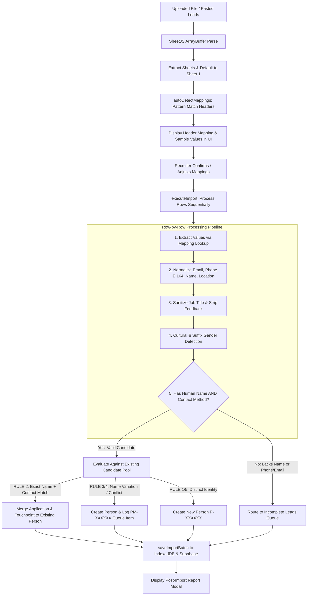

# Import & Export Pipelines Specification

**Repository:** Master Database for AaraTech & ClinisolTech  
**Primary Engine Files:** [src/lib/importEngine.ts](file:///c:/Users/yarla/OneDrive/Documents/Desktop/Master%20database%20for%20Aaratech%20&%20Clinisoltech/src/lib/importEngine.ts), [src/components/import/ImportView.tsx](file:///c:/Users/yarla/OneDrive/Documents/Desktop/Master%20database%20for%20Aaratech%20&%20Clinisoltech/src/components/import/ImportView.tsx)  
**Supporting Libraries:** SheetJS (`xlsx` v0.18.5), Google Gemini REST API  

---

## 1. Supported Ingestion Formats & Ingestion Modes

The application supports two distinct ingestion modes:

1. **File Upload Mode:**
   - Supported extensions: `.xlsx`, `.xls`, `.csv`.
   - Supports multi-sheet workbooks. Recruiter can select which worksheet tab to process.
   - Handled via `XLSX.read(data, { type: 'array', cellDates: true })`.
   - File size limits: Standard browser memory limit (~50MB per workbook, typically 50,000+ rows).

2. **Direct Text Paste Mode:**
   - Accepts copy-pasted tab-delimited text (TSV), comma-delimited text (CSV), space-separated tables, or multi-line vertical candidate blocks.
   - Converts pasted text to an in-memory virtual `File` object using `convertPastedTextToFile(rawText)`:
     - Detects header rows using `detectHeaderColumns()`.
     - Detects vertical candidate blocks using `parseVerticalCandidateBlocks()`.
     - Detects horizontal single-line candidate rows using `parseHorizontalCandidateLine()`.
     - Generates a synthetic Excel workbook with SheetJS ready for the preview and column mapping screen.
   - Alternatively, triggers **Direct Gemini AI Extraction** (`geminiService.extractCandidatesFromRawText`) to parse messy leads into clean candidate objects.

---

## 2. Ingestion Pipeline Architecture

---

## 3. Column Auto-Detection & Mapping Dictionary

The auto-detection engine matches spreadsheet column header names using regex pattern arrays defined in `COLUMN_PATTERNS` ([src/lib/importEngine.ts#L455-L550](file:///c:/Users/yarla/OneDrive/Documents/Desktop/Master%20database%20for%20Aaratech%20&%20Clinisoltech/src/lib/importEngine.ts#L455-L550)):

| Target Column | Matching Header Regex Patterns | Sample Recognized Header Names |
| :--- | :--- | :--- |
| `full_name` | `name`, `full.?name`, `candidate.?name`, `consultant.?name`, `applicant` | `Candidate Name`, `Full Name`, `Consultant Name` |
| `first_name` | `first.?name`, `given.?name`, `fname` | `First Name`, `Given Name` |
| `last_name` | `last.?name`, `surname`, `family.?name`, `lname` | `Last Name`, `Surname` |
| `email` | `^email`, `e.?mail`, `mail.?id`, `primary.?email`, `email.?address` | `Email Address`, `Mail ID`, `E-mail` |
| `secondary_email` | `alt.*email`, `secondary.*email`, `other.*email` | `Alt Email`, `Secondary Email` |
| `phone` | `phone`, `mobile`, `cell`, `contact.?no`, `contact.?number`, `tel` | `Phone Number`, `Mobile`, `Contact No` |
| `secondary_phone` | `alt.*phone`, `secondary.*phone`, `home.*phone` | `Alt Phone`, `Secondary Mobile` |
| `location` | `location`, `city`, `state`, `current.?location`, `address` | `Current Location`, `City / State`, `Location` |
| `preferred_location`| `pref.*loc`, `relocat`, `desired.*loc` | `Preferred Location`, `Relocation Preference` |
| `company` | `company`, `organization`, `agency`, `firm` | `Company`, `Staffing Firm` |
| `job_title` | `job.?title`, `role`, `position`, `applied.?for`, `req.?title` | `Job Title`, `Position`, `Applied Role` |
| `job_id` | `job.?id`, `req.?id`, `job.?code`, `requisition` | `Job ID`, `Req ID` |
| `date_applied` | `date`, `date.?applied`, `assigned.?date`, `submission.?date` | `Date Assigned`, `Application Date` |
| `current_stage` | `stage`, `pipeline.?stage`, `hiring.?stage` | `Application Stage`, `Current Stage` |
| `recruiter_name`| `recruiter`, `sourced.?by`, `owner`, `assigned.?to` | `Recruiter Name`, `Sourced By`, `Owner` |
| `recruiter_feedback`| `feedback`, `notes`, `comments`, `remarks`, `screening` | `Recruiter Feedback`, `Screening Remarks`, `Notes` |
| `resume_link` | `resume`, `cv`, `drive`, `link`, `portfolio` | `Resume Link`, `CV Drive Link` |
| `status` | `status`, `operational.?status`, `candidate.?status` | `Status`, `Current Status` |
| `gender` | `gender`, `sex`, `salutation`, `title` | `Gender`, `Salutation` |

---

## 4. Invalid-Row & Quarantine Handling

Incoming rows are never dropped silently:

1. **Quarantined Incomplete Records (`incomplete_records`):**
   - If a row lacks both a verified candidate name and a valid phone/email, or lacks contact info, it is routed to `newIncompleteRecords`.
   - Reason is categorized as `'missing_contact'`, `'missing_name'`, or `'missing_both'`.
   - Assigned to the selected company (`AaraTech` or `ClinisolTech`).
2. **Rejected Malformed Rows (`errorRows`):**
   - If a row throws an unrecoverable exception during parsing, it is pushed to `errorRows` with the row index, error reason, and verbatim raw data.
   - The user can export rejected error rows to Excel via the post-import dialog.

---

## 5. Export Pipelines & Formats

### 5.1 Candidates Data Export (SheetJS)
- **Source View:** [src/components/candidates/CandidatesListView.tsx](file:///c:/Users/yarla/OneDrive/Documents/Desktop/Master%20database%20for%20Aaratech%20&%20Clinisoltech/src/components/candidates/CandidatesListView.tsx)
- **Export Trigger:** Single-click "Export to Excel" or bulk selection export.
- **Export Format:** Microsoft Excel OpenXML (`.xlsx`).
- **Filename Convention:** `candidates_export_YYYY-MM-DD.xlsx`.
- **Columns Exported (12 Fields):**
  1. `Person ID` (`P-000123`)
  2. `Full Name`
  3. `Gender`
  4. `Email`
  5. `Phone`
  6. `Title / Role`
  7. `Location`
  8. `Company`
  9. `Status`
  10. `Assigned Owner`
  11. `Date Assigned / Applied`
  12. `LinkedIn URL`

### 5.2 Incomplete Leads Export
- **Source View:** [src/components/incomplete/IncompleteProfilesView.tsx](file:///c:/Users/yarla/OneDrive/Documents/Desktop/Master%20database%20for%20Aaratech%20&%20Clinisoltech/src/components/incomplete/IncompleteProfilesView.tsx)
- **Filename:** `incomplete_profiles_YYYY-MM-DD.xlsx`.
- **Fields:** `ID`, `Reason`, `Description`, `Date`, `Raw Name`, `Raw Email`, `Raw Phone`, `Role`, `Company`, `Owner`, `Feedback`.

### 5.3 Acceptance Test Files Generation
- **Source Module:** [src/lib/testDataGenerator.ts](file:///c:/Users/yarla/OneDrive/Documents/Desktop/Master%20database%20for%20Aaratech%20&%20Clinisoltech/src/lib/testDataGenerator.ts)
- **Files Generated:**
  - `acceptance_test_file_a.xlsx`: Baseline dataset containing John Smith (AaraTech), Priya Patel (ClinisolTech), Michael Chang (AaraTech).
  - `acceptance_test_file_b.xlsx`: Overlap dataset with same phone/different email for John Smith (verifies auto-merge) and Aisha Al-Mansoor (ClinisolTech).
  - `acceptance_test_file_c.xlsx`: Conflict dataset with John Smith having different phone/email (verifies Rule 1 no-merge separation).
