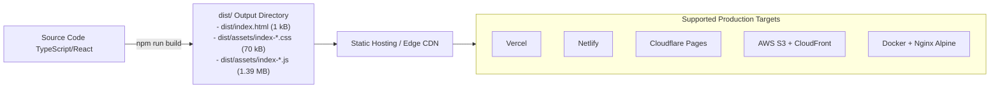

# Deployment & Operations Guide

**Repository:** Master Database for AaraTech & ClinisolTech  
**Architecture:** Static Single Page Application (SPA) with Cloud BaaS (Supabase) & External LLM (Google Gemini)  

---

## 1. Runtime Environment & Dependencies

- **Node.js:** Node.js v20.x or v22.x LTS (Tested and verified on Node v22.14.0 Windows x64).
- **Package Manager:** `npm` (npm v10+).
- **TypeScript:** TypeScript ~6.0.2 / 5.9+.
- **Vite:** Vite 8.3.0+.
- **Browser Compatibility:** Modern evergreen browsers supporting ECMAScript 2022+ and native IndexedDB (Chrome 90+, Edge 90+, Firefox 90+, Safari 15+).

---

## 2. Environment Variables Configuration

The application reads environment configuration during Vite build/development time from `.env` or from runtime `localStorage`.

### Variable Reference Table

| Variable Name | Required | Default / Fallback | Purpose & Usage Description |
| :--- | :---: | :--- | :--- |
| `VITE_SUPABASE_URL` | Yes (for Cloud Sync)| `""` (Prompts in Settings) | HTTPS endpoint URL of the Supabase PostgreSQL project (e.g., `https://[PROJECT-ID].supabase.co`). |
| `VITE_SUPABASE_ANON_KEY`| Yes (for Cloud Sync)| `""` (Prompts in Settings) | Public anonymous API key for authenticating REST & Auth queries against Supabase. |
| `VITE_GEMINI_API_KEY` | Optional | Local storage entry / Code fallback | Google Gemini Generative Language API key for candidate extraction and verification. |

### Configuration File: `.env.example`
```env
# Supabase Configuration
# Replace these with your actual Supabase project URL and anon public key
VITE_SUPABASE_URL=https://your-project-id.supabase.co
VITE_SUPABASE_ANON_KEY=your-anon-public-key-here

# Optional: Google Gemini API Key for AI Ingestion & Rescue
VITE_GEMINI_API_KEY=your-gemini-api-key-here
```

*Note on Precedence:* If a user inputs custom credentials in the in-app **Settings & Supabase** view, those values are saved to browser `localStorage` (`aat_supabase_url`, `aat_supabase_key`, `aat_gemini_api_key`) and override values defined in `.env`.

---

## 3. Development Startup & Commands

### 3.1 Initial Setup
```bash
# 1. Clone repository and navigate to root directory
cd "Master database for Aaratech & Clinisoltech"

# 2. Install production and development dependencies
npm install

# 3. Create local environment file from example template
cp .env.example .env
# Edit .env with your actual Supabase project URL and anon public key
```

### 3.2 Running the Development Server
```bash
# Launches Vite local development server with Hot Module Replacement (HMR)
npm run dev
```
- **Default Local Port:** `http://localhost:5173`
- **Network Interface:** Run `npx vite --host` to expose over local network for cross-device mobile testing.

### 3.3 Verifying Code Correctness
```bash
# 1. Strict TypeScript compile validation
node ./node_modules/typescript/bin/tsc --noEmit

# 2. Production build verification
npm run build
```

---

## 4. Database Setup & Migration Procedure

The application requires PostgreSQL tables and sequences to be initialized in Supabase before cloud synchronization can function.

### Step-by-Step Migration Instructions
1. Log in to the [Supabase Management Console](https://supabase.com).
2. Create a new project or select your existing project.
3. In the left navigation menu, navigate to **SQL Editor**.
4. Open the repository schema file: [supabase/migrations/20261008000001_master_database_schema.sql](file:///c:/Users/yarla/OneDrive/Documents/Desktop/Master%20database%20for%20Aaratech%20&%20Clinisoltech/supabase/migrations/20261008000001_master_database_schema.sql).
5. Copy the entire file contents and paste them into the Supabase SQL Editor.
6. Click **Run**.
7. Confirm that the following 13 tables are created:
   - `people`, `person_emails`, `person_phones`, `jobs`, `applications`, `recruiter_contacts`, `imports`, `import_rows`, `person_status_history`, `possible_matches`, `merge_history`, `audit_log`, `incomplete_records`.
8. Verify that the 31 seed jobs (21 for AaraTech, 10 for ClinisolTech) are inserted into the `jobs` table.

---

## 5. Production Build & Deployment Architecture

Because the application is a pure client-side React SPA, it compiles down to static HTML, CSS, and JavaScript files. It does not require a Node.js server in production.



### 5.1 Compiling the Production Bundle
```bash
npm run build
```
The compiled output is emitted to the `dist/` directory.

### 5.2 Nginx Production Configuration (`nginx.conf`)
When hosting via Docker or a Linux virtual server running Nginx, configure SPA client-side routing to prevent 404 errors on deep links:

```nginx
server {
    listen 80;
    server_name recruiting.aaratech.com;
    root /usr/share/nginx/html;
    index index.html;

    # Gzip Compression for 1.39MB bundle
    gzip on;
    gzip_types text/plain text/css application/json application/javascript text/xml application/xml application/xml+rss text/javascript image/svg+xml;

    location / {
        # Redirect all requests to index.html for React SPA router
        try_files $uri $uri/ /index.html;
    }

    # Cache static assets aggressively
    location ~* \.(js|css|png|jpg|jpeg|gif|ico|svg)$ {
        expires 1y;
        add_header Cache-Control "public, immutable";
    }
}
```

---

## 6. Operational Diagnostics & Monitoring

1. **Database Health Ping:**
   - The application header displays a live status badge: `Supabase: Connected` (green) or `Supabase: Seed/Offline Mode` (amber).
   - Clicking the badge opens the Settings view and triggers a live ping query measuring PostgreSQL query latency in milliseconds (`checkSupabaseHealth()`).
2. **IndexedDB Storage Inspector:**
   - Located in the **Settings & Supabase** screen.
   - Shows active record counts for `peopleCount`, `jobsCount`, `importsCount`, and `matchesCount` currently held in browser storage.
3. **Audit Log Table:**
   - Every administrative action (import, status change, owner change, manual merge, unmerge) writes an audit record to the `audit_log` table, providing full operational accountability.
