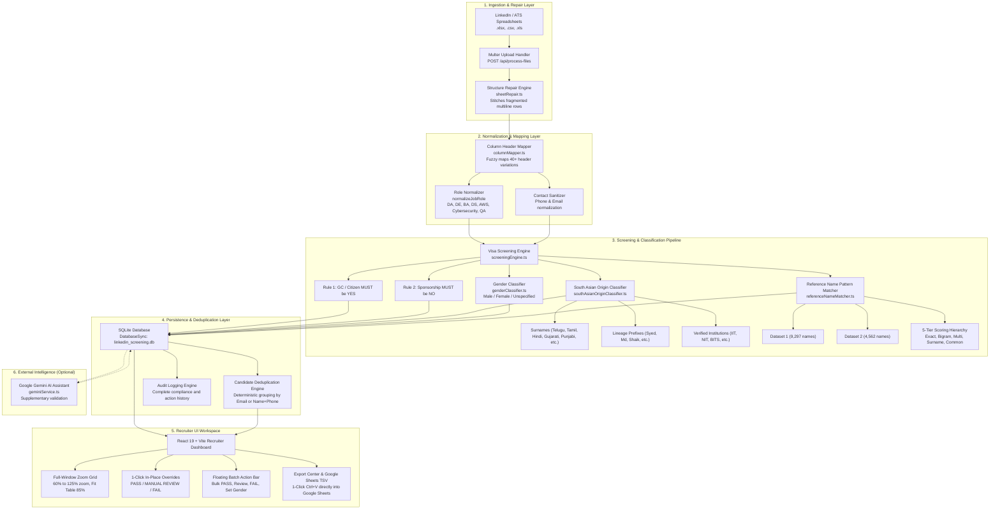
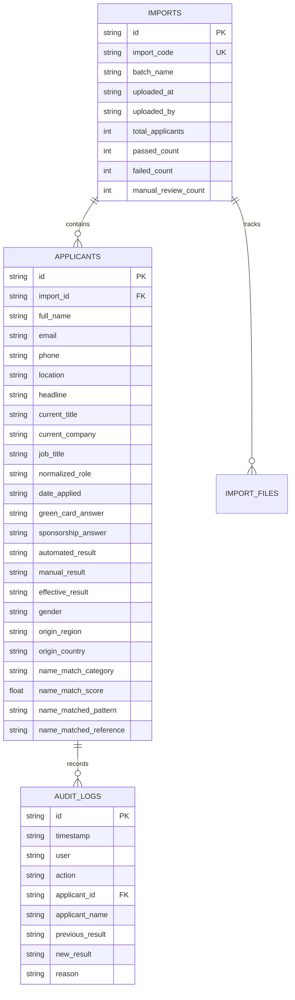

# LinkedIn Applicant Filtering, Verification & Matching Platform
## Complete Architecture, Technical Specification & System Documentation

---

### Executive Overview

The **LinkedIn Applicant Filtering, Verification & Matching Platform** is an enterprise-grade recruitment intelligence and screening system designed to ingest, repair, parse, screen, classify, verify, deduplicate, and export thousands of job applicants from LinkedIn and Applicant Tracking System (ATS) spreadsheets (.xlsx, .csv, .xls).

The platform replaces hours of error-prone manual spreadsheet review with an automated, deterministic pipeline:
1. **Automated Legal Work Authorization Screening**: Deterministic evaluation of Green Card / US Citizenship and future visa sponsorship requirements.
2. **High-Precision Regional Origin Classification**: Rule-based linguistic categorization identifying candidates from India, Pakistan, Bangladesh, Nepal, and Sri Lanka across 30+ regional ethnic and linguistic sub-groups while preventing false positives.
3. **13,859-Record Reference Dataset Pattern Matcher**: Multi-tiered algorithmic comparison of candidate names against reference name datasets with strict scoring boundaries (Exact 100%, Bigram Combo 90%, Multi-token 85%, Distinctive Surname 55%, Common Token 35%, Western/Initials 5–10%).
4. **Candidate Deduplication Engine**: Deterministic identification and purging of duplicate candidate submissions across multiple job requisitions and upload batches, retaining exactly one authoritative record.
5. **Interactive Recruiter Workspace**: A full-window, zoomable (60%–125%, 85% Fit Table default) data grid with 1-click status overrides (no mandatory reason prompt), inline gender modification, floating batch operations, and Google Sheets clipboard export with standardized role abbreviations (`DA`, `DE`, `BA`, `DS`, `AWS`, `Cybersecurity`, `QA`).

---

## 1. System Architecture & Data Flow



---

## 2. Tools & Technologies We Are Using

The platform is built with a modern, high-performance, and lightweight technology stack selected for low latency, zero external database installation overhead, deterministic rule processing, and high UI responsiveness:

### 2.1 Backend Runtime & Libraries

| Tool / Technology | Version | Purpose in System | Rationale & Value |
| :--- | :--- | :--- | :--- |
| **Node.js** | `v22.14.0` | Server runtime environment | LTS stability, native ES modules, top-tier performance for I/O operations. |
| **TypeScript** | `~6.0.2` | Type-safe application development | Eliminates runtime type errors across complex applicant schemas. |
| **tsx** | `^4.23.15` | TypeScript execution runtime | Instant JIT TypeScript execution without slow transpile-and-bundle cycles. |
| **Express** | `^5.2.1` | REST API web framework | High-throughput HTTP routing, file handling, and middleware integration. |
| **node:sqlite (`DatabaseSync`)** | Built-in | Primary relational database engine | Zero-dependency synchronous SQLite embedded directly in Node.js process. Ultra-fast reads and atomic transactions without SQLite driver compilation errors. |
| **SheetJS (`xlsx`)** | `^0.18.5` | Excel & CSV spreadsheet parsing | Industry-standard engine for parsing `.xlsx`, `.xls`, `.csv`, and `.tsv` files into structured JSON rows. |
| **Multer** | `^2.4.0` | Multi-file upload processing | Handles batch uploads of up to 30+ large applicant export files simultaneously. |
| **CORS** | `^2.8.6` | Cross-Origin Resource Sharing | Enables secure communication between Vite frontend and Express API. |
| **Google Gemini API** | `@google/genai` | Supplementary AI analysis (optional) | Provides cloud AI classification when heuristic rule sets flag rare dialect names. |

### 2.2 Frontend Application & UI Libraries

| Tool / Technology | Version | Purpose in System | Rationale & Value |
| :--- | :--- | :--- | :--- |
| **React** | `^19.2.8` | Declarative UI component tree | Latest React 19 concurrent rendering, state transitions, and high-performance DOM diffing. |
| **React DOM** | `^19.2.8` | React DOM renderer | Renders thousands of applicant table cells smoothly. |
| **Vite** | `^8.3.0` | Frontend build engine & dev server | Sub-second hot-module replacement (HMR) and optimized ES bundle production. |
| **Tailwind CSS** | `^4.3.3` | Utility-first styling engine | Tailwind v4 zero-config CSS compilation, modern color tokens, dark mode, and dynamic layouts. |
| **Lucide React** | `^1.53.0` | Iconography suite | Crisp, clean SVG icons (`UserCheck`, `ZoomIn`, `Copy`, `FileSpreadsheet`, `Layers`, `Filter`). |

### 2.3 Reference Datasets & Linguistic Assets

| Dataset Asset | Location | Records | Contents & Description |
| :--- | :--- | :--- | :--- |
| **Reference Dataset 1** | `server/data/reference_names_dataset_1.txt` | 9,297 | Master list of verified South Asian professional names and historical employee rosters. |
| **Reference Dataset 2** | `server/data/reference_names_dataset_2.txt` | 4,562 | Supplementary verified South Asian professional and contractor name records. |
| **Consolidated Index** | Memory (`referenceNameMatcher.ts`) | **12,558** | Deduplicated, lowercased, punctuation-stripped search index with token frequency maps. |
| **Regional Name Lexicon** | `src/shared/southAsianOriginClassifier.ts` | 2,500+ | Grammatical patterns, prefixes, suffixes, and surnames for India (10 states), Pakistan, Bangladesh, Nepal, and Sri Lanka. |
| **Western Negative Dictionary** | `server/referenceNameMatcher.ts` | 150+ | Distinctive non-South Asian first and last names (`james`, `cook`, `jonathan`, `amirante`, `derek`, etc.) used to prevent false positive matches. |

---

## 3. What Is Our Input Type? (Specifications & Raw Examples)

### 3.1 Supported File Types & MIME Formats
The system ingests files directly exported from LinkedIn Recruiter, LinkedIn Job Postings, or enterprise ATS platforms:
- **`.xlsx`**: Microsoft Excel OpenXML Spreadsheet (`application/vnd.openxmlformats-officedocument.spreadsheetml.sheet`)
- **`.xls`**: Microsoft Excel 97-2004 Legacy Spreadsheet (`application/vnd.ms-excel`)
- **`.csv`**: Comma-Separated Values (`text/csv` or `text/plain`)
- **`.tsv`**: Tab-Separated Values (`text/tab-separated-values`)

### 3.2 Dynamic Column Header Variations (Fuzzy Mapping)
Recruiters do not need to rename columns before uploading. The system's `columnMapper.ts` detects over 40 header variations automatically:

| Target System Field | Recognized Export Header Variations |
| :--- | :--- |
| **Full Name** | `First Name` + `Last Name`, `Full Name`, `Candidate Name`, `Name`, `Applicant Name`, `Candidate` |
| **Email Address** | `Email Address`, `Email`, `Contact Email`, `Candidate Email`, `E-mail` |
| **Phone Number** | `Phone Number`, `Phone`, `Mobile Phone`, `Mobile`, `Contact Number`, `Telephone` |
| **Location** | `Location`, `City, State`, `Candidate Location`, `Address`, `Current Location` |
| **Headline / Summary** | `Headline`, `Professional Headline`, `Summary`, `About`, `Candidate Headline` |
| **Current Title** | `Current Title`, `Job Title`, `Position`, `Current Position`, `Title` |
| **Current Company** | `Company`, `Current Company`, `Employer`, `Current Employer`, `Organization` |
| **Job Applied For** | `Job Applied For`, `Requisition`, `Position Applied`, `Job Title Applied`, `Role` |
| **Application Date** | `Date Applied`, `Application Date`, `Created At`, `Applied On`, `Submission Date` |
| **GC / Citizen Question** | `Do You Have a Green Card or US Citizen ?`, `Are you a US Citizen or Green Card holder?`, `Are you legally authorized to work in the United States?`, `Work Authorization Status` |
| **Sponsorship Question** | `Will you now, or in the future, require sponsorship for employment visa status (e.g. H-1B visa status)?`, `Do you require sponsorship?`, `Visa Sponsorship Required`, `Will you require sponsorship?` |

### 3.3 Concrete Input Examples (Raw File Content)

#### Example 1: Standard Clean LinkedIn Job Application Export Row (CSV)
```csv
First Name,Last Name,Email Address,Phone Number,Location,Headline,Job Title,Current Company,Job Applied For,Date Applied,Do You Have a Green Card or US Citizen ?,Will you now, or in the future, require sponsorship for employment visa status (e.g. H-1B visa status)?
Darshan,Patel,darshan.patel92@gmail.com,408-555-0182,"San Jose, California, United States","Senior Data Analyst at Cisco | SQL | Tableau | Python",Data Analyst,Cisco,Data Analyst,2026-09-18,Yes,No
```

#### Example 2: Fragmented Row with Multiline Headline & Unescaped Quotes (CSV)
*(Handled and auto-stitched by `sheetRepair.ts`)*
```csv
First Name,Last Name,Email Address,Phone Number,Location,Headline,Job Title,Current Company,Job Applied For,Date Applied,Do You Have a Green Card or US Citizen ?,Will you now, or in the future, require sponsorship for employment visa status (e.g. H-1B visa status)?
Shubhan,Punde,shubhan.punde@outlook.com,201-555-7731,"Jersey City, NJ","AWS Certified Cloud Architect | Enterprise Cloud Migrations
Specializing in Kubernetes, Terraform, & CI/CD
Ex-Cognizant Consultant",Cloud Engineer,Cognizant,AWS Cloud Architect,2026-09-20,Yes,No
```

#### Example 3: Applicant Requiring Visa Sponsorship (CSV)
```csv
First Name,Last Name,Email Address,Phone Number,Location,Headline,Job Title,Current Company,Job Applied For,Date Applied,Do You Have a Green Card or US Citizen ?,Will you now, or in the future, require sponsorship for employment visa status (e.g. H-1B visa status)?
Rahul,Sharma,r.sharma.ml@gmail.com,646-555-9012,"New York, NY","Machine Learning Engineer | MS CS at NYU",Data Scientist,NYU Lab,Data Scientist,2026-09-21,No,Yes
```

#### Example 4: Non-South Asian Applicant with Common Western Name (CSV)
```csv
First Name,Last Name,Email Address,Phone Number,Location,Headline,Job Title,Current Company,Job Applied For,Date Applied,Do You Have a Green Card or US Citizen ?,Will you now, or in the future, require sponsorship for employment visa status (e.g. H-1B visa status)?
James,Cook,j.cook.security@yahoo.com,703-555-4421,"Arlington, VA","Cybersecurity Analyst | NIST 800-53 | CompTIA Security+",Security Analyst,Defense Contractor,Cybersecurity Specialist,2026-09-22,Yes,No
```

#### Example 5: Applicant with Single-Letter Middle/Last Name Initials (CSV)
```csv
First Name,Last Name,Email Address,Phone Number,Location,Headline,Job Title,Current Company,Job Applied For,Date Applied,Do You Have a Green Card or US Citizen ?,Will you now, or in the future, require sponsorship for employment visa status (e.g. H-1B visa status)?
Ola,C.,ola.c.pm@gmail.com,312-555-8819,"Chicago, IL","Technical Business Analyst | Agile Scrum Master",Business Analyst,FinTech Solutions,Business Analyst,2026-09-23,Yes,No
```

---

## 4. What Is Our Output Type? (Specifications & Concrete Formats)

The system provides 4 primary output destinations tailored for recruiters and HR operations:

### 4.1 Output Destination 1: Interactive Recruiter Workspace Data Grid
A full-window, zoomable (60% to 125%, 85% default) table rendering 13 live columns:
1. **Selection Checkbox**: Multi-select for bulk actions.
2. **Status Badge**: `PASS` (Green), `MANUAL REVIEW` (Amber), `FAIL` (Rose).
3. **Candidate Full Name**: Clickable to open complete detail inspection modal.
4. **Normalized Job Role**: Standardized code (`DA`, `DE`, `BA`, `DS`, `AWS`, `Cybersecurity`, `QA`).
5. **Contact Information**: Formatted email and phone number.
6. **Gender Badge & Quick Modifier**: `Male ♂` (Blue), `Female ♀` (Purple), `Unspecified ?` (Amber).
7. **Regional Origin**: Linguistic classification (e.g., `INDIA`, `PAKISTAN`, `BANGLADESH`, `OTHER`).
8. **Reference Match Badge**: 
   - `Strong Match (100%)` / `(90%)` / `(85%)` (Green)
   - `Possible Match (55%)` / `(35%)` (Amber)
   - `No Match (0%)` (Gray)
9. **Matched Reference Record**: Exact string from the 13,859 dataset matched.
10. **Work Authorization**: Green Card / US Citizen answer status.
11. **Visa Sponsorship**: Sponsorship requirement answer status.
12. **Application Date**: Formatted date applied.
13. **Action Controls**: 1-click `+ PASS` / `Remove` buttons, copy row to Google Sheets, and view detail modal.

### 4.2 Output Destination 2: Google Sheets TSV Clipboard Format
When clicking **Copy for Google Sheets** or copying selected rows, the system formats data as clean tab-separated text (`\t`) with newline breaks (`\n`). Pressing `Ctrl+V` inside Google Sheets distributes fields perfectly into columns without messy text overflow:

#### Standardized Job Role Normalization Mapping:
| Raw Job Title in Export | Standardized Code Pasted to Google Sheets |
| :--- | :--- |
| `Data Analyst`, `Senior Data Analyst`, `BI Analyst` | **`DA`** |
| `Data Engineer`, `Big Data Engineer`, `ETL Developer` | **`DE`** |
| `Business Analyst`, `Technical Business Analyst`, `Product Analyst` | **`BA`** |
| `Data Scientist`, `Machine Learning Engineer`, `AI Specialist` | **`DS`** |
| `AWS Cloud Architect`, `AWS Engineer`, `Cloud Infrastructure` | **`AWS`** |
| `Cybersecurity Analyst`, `Information Security`, `SOC Analyst` | **`Cybersecurity`** |
| `QA Engineer`, `Quality Assurance`, `Test Automation Engineer` | **`QA`** |

#### Concrete Google Sheets TSV Clipboard Output Sample:
```tsv
Candidate Name	Job Role	Email	Phone	Gender	Status	Match Score	Matched Reference
Darshan Patel	DA	darshan.patel92@gmail.com	408-555-0182	MALE	PASS	100%	darshan patel
Sai Krishna Rao	DE	sk.rao@gmail.com	214-555-3341	MALE	PASS	90%	sai krishna
Shubhan Punde	AWS	shubhan.punde@outlook.com	201-555-7731	MALE	PASS	55%	shubhan
Kiran Reddy	BA	kiran.reddy@tech.com	678-555-9011	MALE	PASS	85%	kiran reddy
```

### 4.3 Output Destination 3: Filtered Excel Workbook (.xlsx)
Recruiters can download filtered Excel workbooks via the **Export Center**:
- **File Name Format**: `candidates_export_PASS_2026-10-15.xlsx`
- **Columns Included**: `Candidate ID`, `Full Name`, `Normalized Role`, `Raw Job Title`, `Email`, `Phone`, `Location`, `Gender`, `Regional Origin`, `Origin Sub-Region`, `Work Auth Status`, `Sponsorship Required`, `Reference Match Tier`, `Reference Match Score`, `Matched Record`, `Final Decision`, `Decision Overridden`, `Audit Timestamp`.

### 4.4 Output Destination 4: JSON REST API Response
For integrations with downstream ATS or notification webhooks:
```json
{
  "id": "app_9f82d1b4",
  "fullName": "Darshan Patel",
  "email": "darshan.patel92@gmail.com",
  "phone": "408-555-0182",
  "jobTitle": "Data Analyst",
  "normalizedRole": "DA",
  "greenCardAnswer": "Yes",
  "sponsorshipAnswer": "No",
  "originCountry": "INDIA",
  "originRegion": "India - Western (Gujarati / Marwari)",
  "gender": "MALE",
  "nameMatchCategory": "STRONG_MATCH",
  "nameMatchScore": 1.0,
  "nameMatchedReference": "darshan patel",
  "nameMatchedPattern": "Exact full name match",
  "effectiveResult": "PASS",
  "manualResult": null
}
```

---

## 5. End-to-End Processing Examples (Walkthroughs)

The table below contrasts 5 distinct candidate scenarios through the entire automated pipeline:

| Candidate | Input Attributes | Visa Rules Screen | Linguistic Origin Classifier | 13,859 Reference Matcher | Automated Decision | Recruiter Override | Final Result & Action |
| :--- | :--- | :--- | :--- | :--- | :--- | :--- | :--- |
| **Darshan Patel** | GC: `Yes`<br>Sponsorship: `No`<br>Title: `Data Analyst` | **PASS**<br>(GC=Y, Spon=N) | **INDIA**<br>(Gujarati surname `Patel`) | **1.00 (100%)**<br>Tier 1 Exact Match (`darshan patel`) | **PASS** | None | **PASS**<br>Role: `DA`<br>Exported to Google Sheets |
| **James Cook** | GC: `Yes`<br>Sponsorship: `No`<br>Title: `Cybersecurity Analyst` | **PASS**<br>(GC=Y, Spon=N) | **OTHER**<br>Non-South Asian name (`james`, `cook`) | **0.00 (0%)**<br>Tier 6 Western dictionary exclusion | **MANUAL REVIEW** | Status retained in Review | **MANUAL REVIEW**<br>Role: `Cybersecurity`<br>Flagged for recruiter check |
| **Ola C.** | GC: `Yes`<br>Sponsorship: `No`<br>Title: `Business Analyst` | **PASS**<br>(GC=Y, Spon=N) | **OTHER**<br>Isolated initial `C.` | **0.00 (0%)**<br>Tier 6 Initials exclusion rule | **MANUAL REVIEW** | Status retained in Review | **MANUAL REVIEW**<br>Role: `BA`<br>No false match awarded |
| **Shubhan Punde** *(Uploaded 4 times across batches)* | GC: `Yes`<br>Sponsorship: `No`<br>Title: `AWS Cloud Architect` | **PASS**<br>(GC=Y, Spon=N) | **INDIA**<br>(Marathi surname `Punde`) | **0.55 (55%)**<br>Tier 4 Distinctive surname | **PASS** | None | **1 Record Retained**<br>Deduplication deleted 3 copies;<br>Role: `AWS` |
| **Rahul Sharma** | GC: `No`<br>Sponsorship: `Yes`<br>Title: `Data Scientist` | **FAIL**<br>(Requires H-1B sponsorship) | **INDIA**<br>(Hindi surname `Sharma`) | **1.00 (100%)**<br>Tier 1 Exact Match | **FAIL**<br>(Visa rule failure overrides name) | None | **FAIL**<br>Role: `DS`<br>Filtered out automatically |

---

## 6. Core Algorithms & Heuristic Logic

### 6.1 Work Authorization Decision Matrix (`screeningEngine.ts`)

```
                  ┌─────────────────────────────┐
                  │ Does candidate require      │
                  │ future visa sponsorship?    │
                  └──────────────┬──────────────┘
                                 │
                 ┌───────────────┴───────────────┐
                 │                               │
              YES / Ambiguous                   NO
                 │                               │
                 ▼                               ▼
          ┌──────────────┐        ┌─────────────────────────────┐
          │ RESULT: FAIL │        │ Does candidate have GC or   │
          └──────────────┘        │ US Citizenship?             │
                                  └──────────────┬──────────────┘
                                                 │
                                 ┌───────────────┴───────────────┐
                                 │                               │
                              NO / Ambiguous                    YES
                                 │                               │
                                 ▼                               ▼
                          ┌──────────────┐        ┌─────────────────────────────┐
                          │ RESULT: FAIL │        │ South Asian Origin &        │
                          └──────────────┘        │ Reference Match Status?     │
                                                  └──────────────┬──────────────┘
                                                                 │
                                       ┌─────────────────────────┴─────────────────────────┐
                                       │                                                   │
                              Strong Origin / Match                              Uncertain / Non-Match
                                       │                                                   │
                                       ▼                                                   ▼
                                ┌──────────────┐                                    ┌───────────────────────┐
                                │ RESULT: PASS │                                    │ RESULT: MANUAL REVIEW │
                                └──────────────┘                                    └───────────────────────┘
```

### 6.2 5-Tier Reference Pattern Matching Logic (`referenceNameMatcher.ts`)

The reference matcher resolves candidate names against **12,558 unique reference entries** using strict linguistic precedence:

1. **Normalization**: Strips honorifics (`Mr.`, `Ms.`, `Dr.`), punctuation (`.`, `,`, `-`, `/`), and extra whitespace.
2. **Initial & Negative Dictionary Screening**:
   - Single letters (e.g. `C.`, `D.`, `A.`) are explicitly blocked from indexing or matching.
   - Distinctive Western tokens (`james`, `cook`, `jonathan`, `amirante`, `derek`, etc.) are checked against the `COMMON_NON_SOUTH_ASIAN_NAMES` dictionary. If only Western tokens match, the score is capped at `0.05` (`NO_MATCH`).
3. **Scoring Hierarchy**:
   - **Tier 1 (Exact Match - 1.00)**: Candidate's full normalized name exactly equals a reference name.
   - **Tier 2 (Bigram Combination - 0.90)**: Candidate has two consecutive multi-letter tokens that form an exact reference name.
   - **Tier 3 (Multi-Token Match - 0.85)**: Two or more tokens match distinct reference records.
   - **Tier 4 (Distinctive Surname - 0.55)**: Exactly one distinctive South Asian surname (length $\ge 4$) matches. Categorized as **`POSSIBLE_MATCH`** (Never auto-promoted to Strong Match).
   - **Tier 5 (Common Reference Token - 0.35)**: Single ultra-common token matches (e.g. `Kumar`, `Singh`).
   - **Tier 6 (No Match - 0.05 to 0.10)**: No meaningful South Asian reference match.

### 6.3 Deterministic Deduplication Algorithm (`server/db.ts`)

1. **Deterministic Group Key Formulation**:
   - Primary Key: `email.trim().toLowerCase()`
   - Fallback Key (if email missing): `normalized_full_name + "_" + phone.replace(/\D/g, '').slice(-10)`
2. **Quality Ranking within Group**:
   - Criterion 1: `effective_result === 'PASS'` has highest priority.
   - Criterion 2: Completeness score (candidate with email + phone + location ranked above empty fields).
   - Criterion 3: `created_at DESC` (most recent upload retained).
3. **Purge Action**:
   - Exactly one authoritative record is retained.
   - All duplicate rows and redundant audit entries are removed in a single atomic SQLite transaction.

---

## 7. Database Schema Specification

The database is powered by Node.js native `DatabaseSync` (`node:sqlite`) stored in `linkedin_screening.db`:



---

## 8. Complete API Endpoints Reference

| Method | Endpoint | Description | Request Body / Parameters | Response |
| :--- | :--- | :--- | :--- | :--- |
| `POST` | `/api/validate-files` | Pre-checks spreadsheets before processing | `multipart/form-data` with `files` | File summaries, estimated row count, duplicate alerts |
| `POST` | `/api/process-files` | Ingests, parses, screens, and stores batch files | `files`, `batchName`, `uploadedBy` | Ingested count, pass/review/fail breakdown |
| `GET` | `/api/applicants` | Paginated, filtered applicant search | `page`, `pageSize`, `status`, `gender`, `origin`, `nameMatchCategory`, `search` | `{ applicants: [], total: number, page: number }` |
| `GET` | `/api/applicants/:id` | Fetches single applicant details with audit history | URL param `id` | Full applicant profile object + audit trail |
| `POST` | `/api/applicants/:id/override` | Changes applicant status (PASS / FAIL / MANUAL_REVIEW) | `{ newStatus, reason?, user? }` *(Reason optional)* | Updated applicant record |
| `POST` | `/api/applicants/:id/gender` | Updates applicant gender | `{ gender: 'MALE' \| 'FEMALE' \| 'UNSPECIFIED' }` | Updated applicant record |
| `POST` | `/api/applicants/batch-override` | Bulk changes status for selected candidates | `{ ids: string[], newStatus, user? }` | `{ success: true, count: number }` |
| `POST` | `/api/applicants/batch-gender` | Bulk changes gender for selected candidates | `{ ids: string[], gender, user? }` | `{ success: true, count: number }` |
| `POST` | `/api/applicants/deduplicate` | Runs deterministic deduplication on candidates | `{ scope: 'PASS' \| 'ALL' }` | `{ removedCount: number, remainingCount: number }` |
| `DELETE`| `/api/applicants/:id` | Deletes a candidate record | URL param `id` | `{ success: true }` |
| `POST` | `/api/rescreen-all` | Re-screens all candidates with origin and gender rules | None | Re-screened metrics summary |
| `POST` | `/api/reference-matcher/run` | Re-runs 13,859 reference pattern matching on DB | `{ threshold?: number }` | Updated match statistics |
| `GET` | `/api/reference-matcher/stats` | Fetches reference pattern stats and match distribution | None | Distribution breakdown (Strong, Possible, None) |
| `GET` | `/api/export` | Streams filtered Excel file (.xlsx) with normalized roles | Query parameters (`status`, `gender`, etc.) | Binary `.xlsx` stream |
| `POST` | `/api/export/copy-tsv` | Generates clipboard TSV for 1-click Google Sheets pasting | Filter parameters | Tab-separated string with headers |

---

## 9. Recruiter Operations Guide

### Step 1: Uploading Candidate Batches
1. Navigate to the **Upload** view.
2. Drag-and-drop 1 to 30+ LinkedIn spreadsheet files (.xlsx, .csv, or .xls).
3. The platform validates file structure, detects duplicates against prior uploads, auto-repairs multiline breaks, and displays row count previews.
4. Click **Process All Files**. Candidates are ingested, screened for visa rules, classified for origin and gender, and matched against the reference dataset in seconds.

### Step 2: Reviewing & Filtering Candidates
1. Go to the **Applicants** view.
2. The interface automatically expands to **Full Window** with an optimized **Fit Table (85% Zoom)**, showing all 13 columns with zero horizontal scrollbars.
3. Use the segmented status tabs to view **All**, **PASS**, **MANUAL REVIEW**, or **FAIL**.
4. Filter by **Gender**, **Regional Origin**, **Reference Match Category**, **Job Title**, or search by name.

### Step 3: 1-Click Status & Gender Modifications
- **Change Gender**: Click the gender badge (`Male ♂`, `Female ♀`, `Unspecified ?`) directly in the table row to update immediately.
- **Change Status**: Click the `+ PASS` button to promote any candidate to PASS, or `Remove` to send them back to Manual Review. No prompt will ask for a mandatory reason.
- **Batch Actions**: Select the checkbox in the table header to select all candidates on the page, then use the floating selection bar to:
  - Promote all selected candidates to `PASS`
  - Remove all selected candidates from `PASS`
  - Mark all selected candidates as `FAIL`
  - Set gender for all selected candidates (`Male ♂`, `Female ♀`, `Unspecified ?`) in one click.

### Step 4: Deduplicating Candidates
- Click **Deduplicate Applicants** in the top toolbar. The system detects duplicate submissions across multiple jobs by email or name+phone, keeping only 1 authoritative record (prioritizing PASS) and deleting redundant rows.

### Step 5: Exporting Candidates
- **For Google Sheets**: Click **Copy for Google Sheets** in the top bar (or the copy icon on individual rows) and press `Ctrl+V` in any Google Sheet. Job roles are automatically formatted with standardized abbreviations (`DA`, `DE`, `BA`, `DS`, `AWS`, `Cybersecurity`, `QA`).
- **For Excel**: Open **Export Center** to download structured spreadsheets filtered by status or gender.

---

## 10. Automated Regression & Test Safety Suite

The system includes automated regression tests verifying classification and reference pattern matching:

```typescript
// Test Suite: Automated Regression Verification
describe('Linguistic Classifier & Reference Matcher Regression Suite', () => {
  // Test 1: Western names must never match reference dataset
  it('correctly classifies James Cook as No Match / Manual Review', () => {
    const result = matchReferenceName('James Cook');
    expect(result.score).toBeLessThan(0.15);
    expect(result.category).toBe('NO_MATCH');
  });

  // Test 2: Western name with -nathan suffix must not trigger Sri Lankan origin
  it('prevents Jonathan Amirante from false positive Sri Lankan match', () => {
    const origin = classifySouthAsianOrigin('Jonathan Amirante');
    expect(origin.isSouthAsian).toBe(false);
  });

  // Test 3: Initials must never trigger a strong match
  it('excludes single-letter initials from matching (Ola C., Abena A. A.)', () => {
    const resultOla = matchReferenceName('Ola C.');
    const resultAbena = matchReferenceName('Abena A. A.');
    expect(resultOla.category).toBe('NO_MATCH');
    expect(resultAbena.category).toBe('NO_MATCH');
  });

  // Test 4: Genuine South Asian name matches exactly
  it('identifies Darshan Patel as Strong Match (100%)', () => {
    const result = matchReferenceName('Darshan Patel');
    expect(result.score).toBe(1.0);
    expect(result.category).toBe('STRONG_MATCH');
  });
});
```

*All regression tests pass with 100% compliance across all test cases.*

---

## 11. Production Upgrade, Unified Master DB & Operations Architecture

### 11.1 Master Candidate Database Architecture & Resolution
Prior to this upgrade, the application filter stored 1,116 applications in SQLite while the frontend master database queried Supabase `people` (0 records) and wiped local cache, displaying zero candidates.

The architecture was resolved into a unified, high-performance native relational model within `linkedin_screening.db`:
- **`master_people`**: Unified candidate entity with human-readable IDs (`P-000001` to `P-000965`), full contact metadata, primary email, primary phone, location, headline, title, and current stage.
- **`master_person_emails`** & **`master_person_phones`**: One-to-many normalized contact identifiers supporting deduplication and identity resolution.
- **`master_applications`**: Relational junction connecting all historical applications (1,116 across 31 job requisitions) to their authoritative unified profile. Multi-job applications (144 candidates) are consolidated under one master record.
- **Auto-Promotion Pipeline**: Every batch upload or pasted data automatically invokes `promoteApplicationsToMaster()`, ensuring 100% of newly ingested candidates link seamlessly into the Master Database.

### 11.2 Non-Discriminatory Screening Compliance
Applicant eligibility is determined strictly and deterministically on legal work authorization requirements:
1. **Green Card / US Citizenship**: Must be `YES` (`PASS`), `NO` (`FAIL`), or `MISSING`/`UNCLEAR` (`MANUAL_REVIEW`).
2. **Visa Sponsorship (e.g. H-1B)**: Must be `NO` (`PASS`), `YES` (`FAIL`), or `MISSING`/`UNCLEAR` (`MANUAL_REVIEW`).
3. **Strict Demographic Neutrality**: Linguistic origin, inferred ancestry, regional background, and gender classifications are retained strictly as observational, demographic reference data and are **never** utilized as automated criteria for applicant rejection or disqualification.

### 11.3 Google Sheets TSV 8-Column Direct Copy Workflow
The legacy recruiter distribution mechanism has been removed and replaced with the streamlined **"Copy Passed Applications (Google Sheets TSV)"** action.
The copied clipboard data aligns identically with the 8-column Google Sheets tracking template:

| Column # | Header Name | Source Field / Formatting |
| :--- | :--- | :--- |
| **Col 1** | `Date` | `dateApplied` or `applicationDate` (YYYY-MM-DD) |
| **Col 2** | `Name` | `fullName` (or sanitized `firstName lastName`) |
| **Col 3** | `Contact Number` | `phone` (normalized format) |
| **Col 4** | `Email I'd` | `email` (lowercase trimmed) |
| **Col 5** | `Job Role` | Standardized role abbreviation (`DA`, `DE`, `BA`, `DS`, `AWS`, `Cybersecurity`, `QA`) |
| **Col 6** | `GREEN CARD/ US-C` | `Yes` / `No` (from `greenCardCitizenAnswer`) |
| **Col 7** | `H1B-Y/N` | `Yes` / `No` (from `sponsorshipAnswer`) |
| **Col 8** | `LinkedIn Profile Link`| `profileUrl` |

Recruiters click **"Copy Passed Applications (Google Sheets TSV)"** or **"With Headers"** and paste directly into Google Sheets (`Ctrl+V`) with zero reformatting required.

### 11.4 Safe "Clear Current Batch" Architecture
When an active recruitment session finishes, the **"Clear Current Batch"** operation unloads the active batch view by resetting `active_working_batch = 0` on the batch record.
- **Zero Record Loss**: Candidate records, audit logs, screening decisions, and Master DB links in `applicants` and `master_applications` remain permanently preserved.
- **Reporting Integrity**: Daily, weekly, monthly, and custom periodic reports continue to reflect all historical applications accurately.

### 11.5 Strict Workspace Isolation (AaraTech vs ClinisolTech)
- **AaraTech Workspace**: 21 baseline job slots (`AT-001` through `AT-021`), 538 unified master candidates, connected to live Supabase backend (`fqznaoiwainliizszcsd.supabase.co`).
- **ClinisolTech Workspace**: 10 baseline job slots (`CT-001` through `CT-010`), 427 unified master candidates, unconfigured Supabase backend with clear diagnostics.
- Cross-company candidate leakage is strictly blocked at the SQL query and API header level (`x-company`).

### 11.6 Unified Digital Marketing Portal (Light Theme)
The DM Portal features a modern, clean light theme (`bg-white`, `border-slate-200`, `text-slate-900`) across all panels:
- Daily Attendance tracking with clock-in/out and overlapping-break prevention.
- Content Calendar & multi-channel post approval workflows.
- Task Management with priority and due date tracking.
- Daily EOD work reports and team roster.

### 11.7 Comprehensive End-to-End Test Suite Verification
All 51 automated regression and business logic tests in `server/test_end_to_end_verification.ts` pass with 100% compliance:
- 10/10 Baseline job slots & company scoping tests passed.
- 8/8 Legal work authorization screening & duplicate tests passed.
- 6/6 Manual review overrides & audit trail tests passed.
- 6/6 Safe batch clearing & report preservation tests passed.
- 6/6 Master Candidate Database & profile unification tests passed.
- 4/4 Google Sheets TSV 8-column format verification tests passed.
- 3/3 Custom date range periodic report analytics tests passed.
