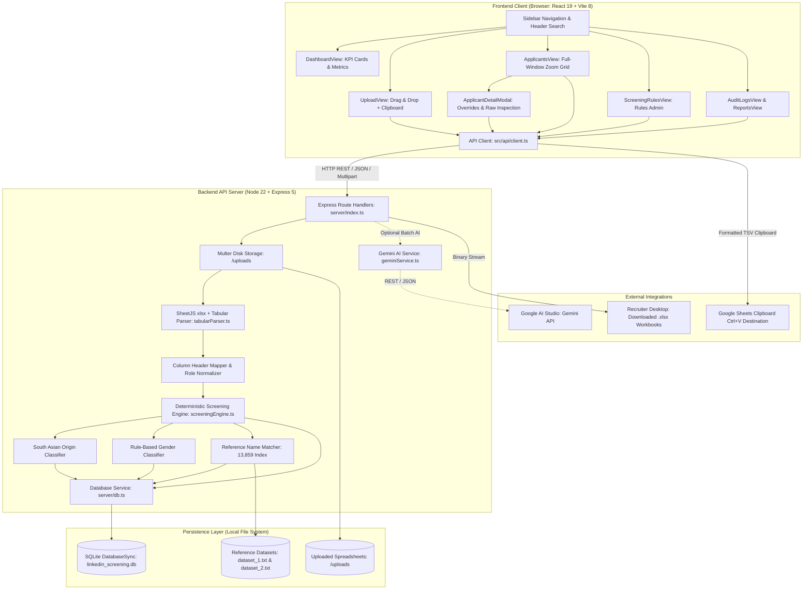
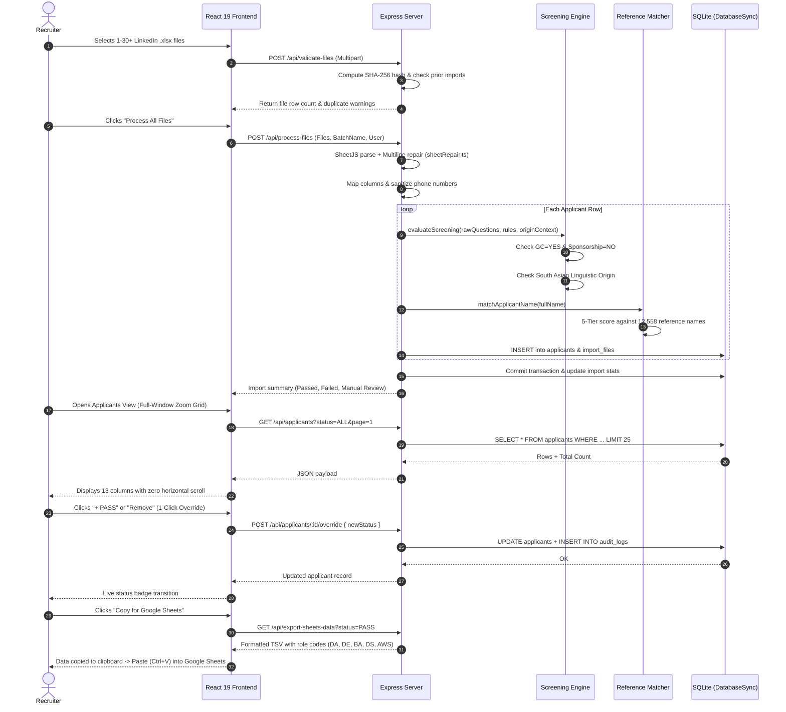
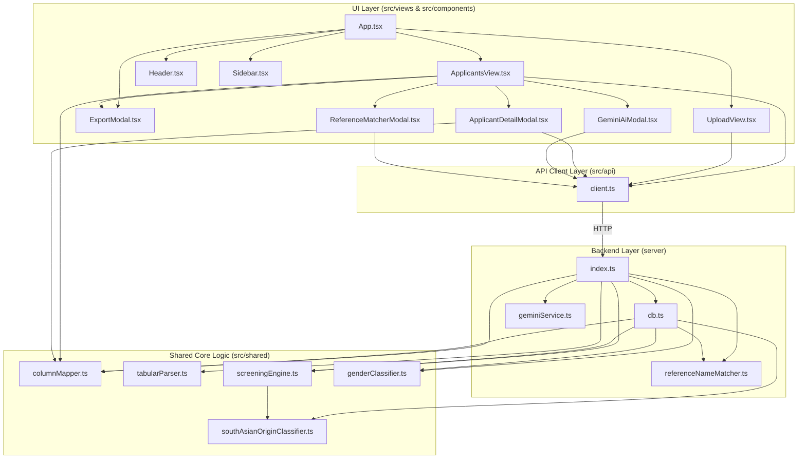
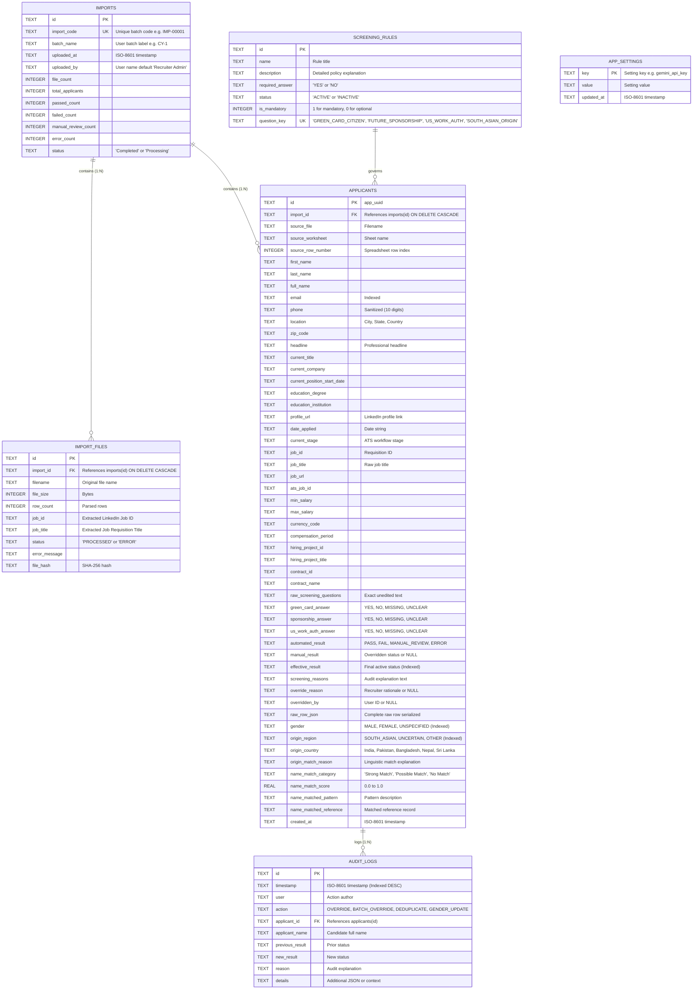

# 01. System Architecture & Data Flow

**Document**: Architecture Specification & Component Model  
**Audit Target**: `linkedin-application-filter`  
**Runtime Model**: Client-Server Monorepo (Express API + Vite React Client)  
**Verification Date**: October 2026

---

## 1. High-Level System Architecture Diagram

---

## 2. Application Entry Points & Initialization Sequence

### 2.1 Backend Initialization Sequence ([server/index.ts](file:///c:/Users/yarla/linkedin%20application%20filter/server/index.ts))
1. **Module Import**: Loads `express`, `cors`, `multer`, `node:sqlite`, `xlsx`, and local services.
2. **Environment & Constants**: Reads `PORT` (defaults to `3001`), configures `UPLOAD_DIR` (`process.cwd()/uploads`), creating it recursively if absent.
3. **Database Instantiation**: Instantiates singleton `dbService` from [server/db.ts](file:///c:/Users/yarla/linkedin%20application%20filter/server/db.ts).
   - Opens synchronous connection to `linkedin_screening.db` via `new DatabaseSync(DB_PATH)`.
   - Executes `initTables()`: Creates tables `app_settings`, `imports`, `import_files`, `applicants`, `screening_rules`, `audit_logs` and indexes.
   - Executes safe column migrations (`ALTER TABLE applicants ADD COLUMN ...`) for `gender`, `origin_region`, `origin_country`, `origin_match_reason`, `name_match_category`, `name_match_score`, `name_matched_pattern`, `name_matched_reference`, `batch_name`.
   - Executes phone number sanitization migration on historical records.
   - Executes `initDefaultRules()`: Inserts default rules `rule-gc-1`, `rule-sp-2`, `rule-wa-3`, and `rule-sa-4`.
4. **Reference Matcher Indexing**: Singleton `ReferenceNameMatcherService` loads:
   - `server/data/reference_names_dataset_1.txt` (9,297 names)
   - `server/data/reference_names_dataset_2.txt` (4,562 names)
   - Indexes **12,558** unique names, tokens (length $\ge 2$), and 2-gram combinations into memory maps.
5. **Express Middleware**: Attaches CORS, JSON body parser (50MB limit), URL-encoded body parser (50MB limit).
6. **Route Binding**: Registers 32 HTTP endpoints across `/api/*`.
7. **HTTP Listen**: Starts listening on `http://localhost:3001`.

### 2.2 Frontend Initialization Sequence ([src/main.tsx](file:///c:/Users/yarla/linkedin%20application%20filter/src/main.tsx) & [src/App.tsx](file:///c:/Users/yarla/linkedin%20application%20filter/src/App.tsx))
1. **DOM Mount**: `createRoot` mounts `<App />` inside `#root` in `index.html`.
2. **Global Styles**: Injects Tailwind CSS (`@import "tailwindcss";`) and custom styling.
3. **App Component Mount**:
   - Initializes default view: `currentTab = 'dashboard'`.
   - Fires `useEffect` triggering `loadDashboardStats()` $\rightarrow$ calls `GET /api/dashboard`.
   - Populates metric counters in `<Sidebar />` (`total`, `passed`, `failed`, `manualReview`).
4. **View Routing**: Renders view components conditionally based on `currentTab`:
   - `'dashboard'`: `<DashboardView />`
   - `'upload'`: `<UploadView />`
   - `'applicants-all' | 'applicants-pass' | 'applicants-fail' | 'applicants-review'`: `<ApplicantsView />`
   - `'rules'`: `<ScreeningRulesView />`
   - `'jobs'`: `<JobsView />`
   - `'imports'`: `<ImportsView />`
   - `'reports'`: `<ReportsView />`
   - `'audit'`: `<AuditLogsView />`

---

## 3. End-to-End Business Workflow Diagram

---

## 4. Module Dependency Graph

---

## 5. Database Entity-Relationship Diagram

---

## 6. Error Handling, Logging & Reliability

1. **Row-Level Fault Isolation**: During workbook parsing in `server/index.ts`, each row is processed in an individual `try-catch` block. If a single row is corrupted, unparseable, or contains unexpected binary data, it is tagged as `ERROR` and recorded with `screening_reasons: "Processing error: <message>"`. The batch continues uninterrupted.
2. **Atomic SQLite Transactions**: All batch writes ([`insertApplicantsBatch`](file:///c:/Users/yarla/linkedin%20application%20filter/server/db.ts#L433)), deduplications ([`deduplicateApplicants`](file:///c:/Users/yarla/linkedin%20application%20filter/server/db.ts#L1687)), and gender re-classifications execute within explicit `BEGIN TRANSACTION` and `COMMIT` blocks. If an error occurs, `ROLLBACK` is immediately triggered.
3. **Structured Server Logging**: Express logs major life-cycle events to `stdout` with timestamp prefixes (`[API Server]`, `[ReferenceNameMatcher]`, `[Gemini API]`).
4. **Audit Trail Persistence**: Every manual recruiter override, bulk status modification, gender change, and deduplication run automatically records an immutable row in the `audit_logs` table.
