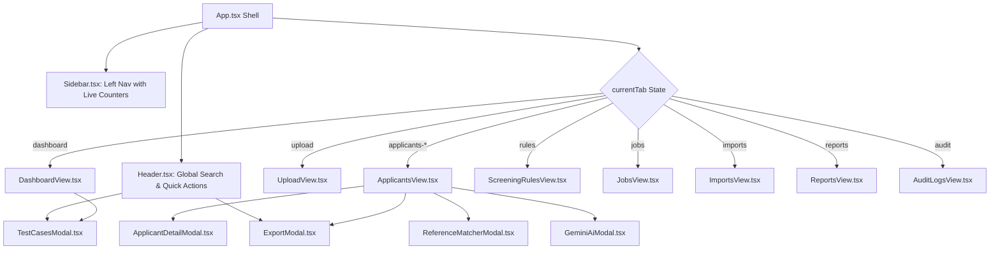

# 06. Frontend Architecture & User Interface Experience

**Document**: Frontend Component Hierarchy, State Management & UX Audit  
**Framework**: React `19.2.8` + Vite `8.3.0`  
**Styling Engine**: Tailwind CSS `^4.3.3` with `@tailwindcss/vite`  
**Iconography**: Lucide React `^1.53.0`  
**Primary Entry**: [src/App.tsx](file:///c:/Users/yarla/linkedin%20application%20filter/src/App.tsx)  
**Audit Date**: October 2026

---

## 1. Frontend Architecture & Navigation Shell

The application is structured as a client-side Single Page Application (SPA). The view routing is handled by stateful navigation (`currentTab: NavTab`) managed in `App.tsx` without an external router library like `react-router-dom`:

---

## 2. Screen-by-Screen Component Inventory

### 2.1 Screen: Applicants Data Grid (`ApplicantsView.tsx`)
- **File**: [src/views/ApplicantsView.tsx](file:///c:/Users/yarla/linkedin%20application%20filter/src/views/ApplicantsView.tsx)
- **Role**: Primary recruiter workspace for candidate review, manual dispositioning, and export.
- **Key Features**:
  1. **Full-Window Scaling & Zoom Controls**:
     - Controlled by state: `zoomLevel` (`number`, default: `85`) and `isFullWidth` (`boolean`, default: `true`).
     - Action buttons: `ZoomIn` (+5%), `ZoomOut` (-5%), `Fit Table (85%)`, `100%`.
     - Container sets `zoom: ${zoomLevel}%` and `max-w-[99vw] px-2 sm:px-4`, allowing all 13 columns to fit comfortably on standard laptop screens without horizontal scrollbars.
  2. **13 Structured Table Columns**:
     - Column 1: `Select All` checkbox (Header) / Row selection checkbox.
     - Column 2: `Status Badge` (`PASS`, `MANUAL REVIEW`, `FAIL`).
     - Column 3: `Candidate Full Name` (Clickable to open inspection modal).
     - Column 4: `Role` (Normalized abbreviation: `DA`, `DE`, `BA`, `DS`, `AWS`, `Cybersecurity`, `QA`).
     - Column 5: `Email & Phone` (Formatted and sanitized).
     - Column 6: `Gender Badge` (Inline interactive dropdown: `Male ♂` [Blue], `Female ♀` [Purple], `Unspecified ?` [Amber]).
     - Column 7: `Regional Origin` (Linguistic origin pill e.g. `India`, `Pakistan`, `OTHER`).
     - Column 8: `Reference Match Score` (Color-coded badge: Green $\ge 85\%$, Amber $35\%-55\%$, Gray $\le 10\%$).
     - Column 9: `Matched Record` (Exact reference string matched from the 13,859 dataset).
     - Column 10: `Work Authorization` (Green Card / US Citizen answer status).
     - Column 11: `Sponsorship Required` (Sponsorship answer status).
     - Column 12: `Date Applied` (Formatted date string).
     - Column 13: `Actions`:
       - `+ PASS`: 1-click status promotion to PASS.
       - `Remove`: 1-click removal of candidate from PASS to Manual Review.
       - `Copy`: 1-click copy of candidate row to Google Sheets TSV format.
       - `Eye`: Opens detail inspection modal.
  3. **Multi-Row Floating Batch Action Bar**:
     - Appears at bottom of screen when rows are selected (`"N candidates selected"`).
     - Buttons:
       - `Add to PASS`: Bulk promotes selected candidates to PASS.
       - `Remove from PASS`: Bulk moves selected candidates to Manual Review.
       - `Mark FAIL`: Bulk moves selected candidates to FAIL.
       - `Set Gender`: Bulk dropdown with 1-click options: `Male ♂`, `Female ♀`, `Unspecified ?`.
       - `Deselect All`: Clears selection.
  4. **Deduplicate Candidates Action**:
     - Button in top toolbar triggers `POST /api/applicants/deduplicate`.
     - Displays confirmation alert showing exact count of removed duplicate rows and unique candidates preserved.

---

### 2.2 Modal: Candidate Detail Inspector (`ApplicantDetailModal.tsx`)
- **File**: [src/views/ApplicantDetailModal.tsx](file:///c:/Users/yarla/linkedin%20application%20filter/src/views/ApplicantDetailModal.tsx)
- **Tabs**:
  - `Details`: Profile overview, contact cards, screening audit reasons, reference match details.
  - `Raw Screening`: Exact unparsed multiline screening questions cell from LinkedIn.
  - `Raw Row Data`: Formatted JSON inspector showing every preserved column from the original export.
  - `Override`: Manual status changer with optional reason field.
- **Interactive Controls**:
  - Inline gender toggle buttons (`Male ♂`, `Female ♀`, `Unspecified`).
  - `Copy Google Sheets Row`: Generates 8 clean columns and copies directly to OS clipboard.
  - Status action buttons: `+ PASS`, `Remove from PASS`, `Mark as FAIL`.

---

### 2.3 Screen: File Ingestion & Upload (`UploadView.tsx`)
- **File**: [src/views/UploadView.tsx](file:///c:/Users/yarla/linkedin%20application%20filter/src/views/UploadView.tsx)
- **Tabs**:
  - `Upload Spreadsheets`: Drag-and-drop zone supporting `.xlsx`, `.xls`, `.csv`, `.pdf` up to 50 files. Displays pre-validation file chips with detected row counts and duplicate warning alerts.
  - `Paste Clipboard Data`: Direct multi-line textarea supporting `Ctrl+V` pasting of TSV or CSV data copied from external spreadsheets or browser windows.
- **Controls**: Batch Requisition Name input, `Process All Files` action button, live progress bar.

---

### 2.4 Screen: Executive Dashboard (`DashboardView.tsx`)
- **File**: [src/views/DashboardView.tsx](file:///c:/Users/yarla/linkedin%20application%20filter/src/views/DashboardView.tsx)
- **KPI Metrics Displayed**:
  - Files Processed count.
  - Total Applicants Ingested.
  - Passed Applicants count and percentage bar.
  - Failed Applicants count and percentage bar.
  - Manual Review Queue count and percentage bar.
  - System Errors count.
- **Direct Navigation Links**: Quick-start buttons navigating to Upload screen or launching the 12 Test Cases runner.

---

### 2.5 Screen: Screening Rules Configuration (`ScreeningRulesView.tsx`)
- **File**: [src/views/ScreeningRulesView.tsx](file:///c:/Users/yarla/linkedin%20application%20filter/src/views/ScreeningRulesView.tsx)
- **Cards**:
  - Mandatory Rules (Locked with lock icon):
    - `Green Card / US Citizen` (Mandatory answer: `YES`).
    - `Future Sponsorship` (Mandatory answer: `NO`).
  - Optional Rules (Toggleable):
    - `US Work Authorization` (Answer: `YES`).
    - `South Asian Profile / Name Filter` (Answer: `SOUTH_ASIAN`).
- **Action**: `Re-screen All Applicants` button triggers database-wide re-evaluation.

---

### 2.6 Screen: Job Requisitions Summary (`JobsView.tsx`)
- **File**: [src/views/JobsView.tsx](file:///c:/Users/yarla/linkedin%20application%20filter/src/views/JobsView.tsx)
- **Cards Grid**: Displays a card for each job requisition title with total applicant count, screening pass rate %, and color-coded progress bar (Green for Pass, Red for Fail, Amber for Review).
- **Interactivity**: Clicking any job card navigates directly to `ApplicantsView` filtered for that specific job.

---

### 2.7 Screen: Import History & Audits (`ImportsView.tsx`)
- **File**: [src/views/ImportsView.tsx](file:///c:/Users/yarla/linkedin%20application%20filter/src/views/ImportsView.tsx)
- **Accordion Table**: Lists all historical upload batches with import code (`IMP-xxxxx`), batch name, uploader, timestamp, and status. Expanding any row displays individual files contained in the batch, file sizes, and row counts.

---

### 2.8 Screen: Processing Reports & Audits (`ReportsView.tsx`)
- **File**: [src/views/ReportsView.tsx](file:///c:/Users/yarla/linkedin%20application%20filter/src/views/ReportsView.tsx)
- **Report Document Layout**: Formatted printable summary report displaying:
  - Total Applicants and files audited.
  - Mandatory Legal Screening questions audit breakdown.
  - Dispositions summary table.
  - Top action buttons: `Copy for Google Sheets`, `Export XLSX`, `Export CSV`.

---

### 2.9 Screen: Settings & Audit Logs (`AuditLogsView.tsx`)
- **File**: [src/views/AuditLogsView.tsx](file:///c:/Users/yarla/linkedin%20application%20filter/src/views/AuditLogsView.tsx)
- **Audit Table**: Chronological table of all security and recruiter actions showing timestamp, user, action type, candidate subject, state transition, and reason text.

---

### 2.10 Modals & Dialogs
- **`TestCasesModal.tsx`**: Executes the 12 core acceptance test cases via `/api/run-tests` and displays a real-time compliance scorecard.
- **`ExportModal.tsx`**: Dual-mode export dialog allowing recruiters to download files (`xlsx`, `csv`, `tsv`, `json`) or copy formatted TSV directly to clipboard.
- **`ReferenceMatcherModal.tsx`**: Displays 13,859 dataset statistics, top 2-grams, similarity threshold slider, and an on-demand re-matching runner.
- **`GeminiAiModal.tsx`**: Google Gemini API key configuration and batch classification runner.

---

## 3. UI-to-Backend Connection Gaps & Dead Elements

1. **AuditLogsView Static Compliance Banner**:
   - In [src/views/AuditLogsView.tsx:56-59](file:///c:/Users/yarla/linkedin%20application%20filter/src/views/AuditLogsView.tsx#L56-L59), the card displays: *"Compliance Guardrail: Zero Ethnicity / AI Inference"*.
   - **Gap**: This is outdated static marketing copy from early development. In reality, South Asian origin classification and Gemini AI integrations are actively present in the codebase.
2. **Missing Client Router**:
   - Direct browser URL changes (e.g. typing `http://localhost:5173/applicants`) are not supported; all navigation is purely in-memory via `currentTab`. Refreshing the browser resets the view to `dashboard`.
