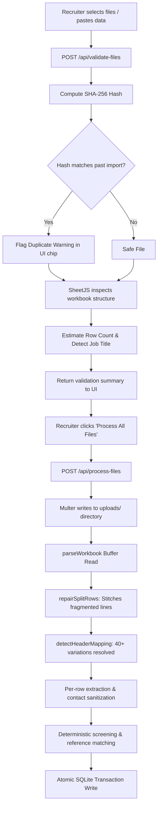

# 07. Ingestion & Export Data Pipelines

**Document**: File Ingestion, Structure Repair, Normalization & Export Pipelines  
**Audit Target**: `linkedin-application-filter`  
**Engines**: Multer `^2.4.0`, SheetJS `xlsx ^0.18.5`, Custom RFC-4180 Parser, Custom Multiline Repair Engine  
**Audit Date**: October 2026

---

## 1. Supported Input File Formats & Technical Limits

| Format | Extension | MIME Type | Parser Mechanism | Configured Limit |
| :--- | :--- | :--- | :--- | :--- |
| **Excel OpenXML** | `.xlsx` | `application/vnd.openxmlformats-officedocument.spreadsheetml.sheet` | SheetJS `XLSX.read(buf, { type: 'buffer' })` | 50MB per file, max 50 files per batch |
| **Legacy Excel** | `.xls` | `application/vnd.ms-excel` | SheetJS `XLSX.read(buf, { type: 'buffer' })` | 50MB per file, max 50 files per batch |
| **Comma-Separated** | `.csv` | `text/csv`, `text/plain` | SheetJS + Custom RFC-4180 Parser fallback | 50MB per file, max 50 files per batch |
| **Tab-Separated** | `.tsv` | `text/tab-separated-values` | SheetJS + Custom RFC-4180 Parser fallback | 50MB per file, max 50 files per batch |
| **Adobe PDF** | `.pdf` | `application/pdf` | `pdf-parse` (line extraction) | 50MB per file |
| **Direct Clipboard** | Raw text | `text/plain` | `parseTabularText` in [src/shared/tabularParser.ts](file:///c:/Users/yarla/linkedin%20application%20filter/src/shared/tabularParser.ts) | 50MB JSON payload limit |

---

## 2. Ingestion & Pre-Validation Pipeline

### 2.1 Duplicate File Detection
- **Mechanism**: Every uploaded file is hashed with `crypto.createHash('sha256').update(fileBuffer).digest('hex')`.
- **Query**: [server/db.ts:344](file:///c:/Users/yarla/linkedin%20application%20filter/server/db.ts#L344) queries `import_files` for matching `file_hash` or `filename`.
- **User Alert**: If a duplicate is identified, the file chip in `UploadView` displays an amber warning badge stating the original upload date and import ID, allowing recruiters to uncheck or force-process the file.

---

## 3. Structural Repair Engine for Fragmented Rows

### 3.1 Problem Solved
LinkedIn spreadsheet exports often contain multiline candidate headlines or unescaped commas in question-and-answer fields. When opened or pasted across applications, a single candidate record can split across 2 or 3 lines:
- **Fragment Type 1 (Screening Question Continuation)**: A line begins with `: No, Are you legally authorized to work in the United States? : Yes...`.
- **Fragment Type 2 (Mid-Row Headline Split)**: A newline splits the headline cell in half, shifting all subsequent columns (Company, Location, Date, Questions) horizontally by 1 or more columns.

### 3.2 Implementation: `repairSplitRows()`
Implemented in [src/shared/tabularParser.ts:126](file:///c:/Users/yarla/linkedin%20application%20filter/src/shared/tabularParser.ts#L126):
1. **Duplicate Header Suppression**: Checks if an intermediate row repeats the header row (common when concatenating exports) and discards it.
2. **Screening Question Continuation Stitching**: Detects lines starting with `:` or boolean screening answers with $\le 2$ populated columns. Appends the text back to `prevRow['Screening Questions']`.
3. **Shifted Headline Row Alignment** (`mergeShiftedHeadlineRow`): Detects when `prevRow` terminates at `Headline` and the next row contains shifted company and date data. Re-aligns all 22 target columns into `prevRow`.

---

## 4. Dynamic Column Header Mapping (40+ Variations)

Implemented in [src/shared/columnMapper.ts](file:///c:/Users/yarla/linkedin%20application%20filter/src/shared/columnMapper.ts):

| Target Field | Recognized Header Patterns (Case-Insensitive Fuzzy Matching) |
| :--- | :--- |
| `fullName` | `full name`, `fullname`, `candidate name`, `applicant name`, `name`, `person name` |
| `firstName` | `first name`, `firstname`, `first_name`, `first`, `given name` |
| `lastName` | `last name`, `lastname`, `last_name`, `last`, `surname`, `family name` |
| `email` | `email address`, `email`, `emailaddress`, `candidate email`, `e-mail`, `email i'd`, `email id` |
| `phone` | `phone number`, `phone`, `phonenumber`, `mobile number`, `mobile`, `candidate phone`, `cell phone`, `contact number` |
| `location` | `general location`, `location`, `candidate location`, `city, state`, `city`, `address`, `current location` |
| `headline` | `headline`, `professional headline`, `candidate headline`, `summary` |
| `currentTitle` | `current title`, `job title (current)`, `title`, `position`, `current position`, `most recent title` |
| `currentCompany` | `current company`, `company`, `employer`, `current organization`, `most recent company` |
| `jobId` | `job id`, `linkedin job id`, `job req id`, `requisition id`, `job number`, `jobid` |
| `jobTitle` | `job title`, `position title`, `job name`, `requisition title`, `role`, `job role`, `designation` |
| `rawScreeningQuestions` | `screening questions`, `screening question answers`, `custom questions`, `questions & answers`, `screening` |

---

## 5. Export Pipelines & Formats

The platform provides 3 distinct export mechanisms:

### 5.1 Pipeline 1: Google Sheets 1-Click Clipboard TSV
- **Endpoint**: `GET /api/export-sheets-data` or frontend helper `formatGoogleSheetsRow()`
- **Format**: Tab-delimited (`\t`) text with newline breaks (`\n`).
- **Standardized 8-Column Schema**:
  1. `Candidate Name`
  2. `Job Role` (Standardized codes: `DA`, `DE`, `BA`, `DS`, `AWS`, `Cybersecurity`, `QA`)
  3. `Gender` (`MALE`, `FEMALE`, `UNSPECIFIED`)
  4. `Email Address`
  5. `Phone Number` (Sanitized 10-digit format)
  6. `Status` (`PASS`, `MANUAL REVIEW`, `FAIL`)
  7. `Match Score` (Percentage string e.g. `100%`, `90%`, `55%`)
  8. `Matched Reference` (Exact reference dataset string matched)
- **Recruiter Usage**: Clicking **Copy for Google Sheets** copies the formatted TSV to the clipboard. The recruiter presses `Ctrl+V` inside Google Sheets to paste rows directly into aligned columns.

### 5.2 Pipeline 2: Binary Excel Workbook (.xlsx)
- **Endpoint**: `GET /api/export?format=xlsx&status=PASS`
- **Engine**: SheetJS `XLSX.write(wb, { type: 'buffer', bookType: 'xlsx' })`.
- **Response Headers**:
  - `Content-Type: application/vnd.openxmlformats-officedocument.spreadsheetml.sheet`
  - `Content-Disposition: attachment; filename="applicants_PASS_1729000000000.xlsx"`
- **Templates**:
  - `clean`: 8 standardized columns.
  - `full`: 26 comprehensive candidate, screening, reference matching, and audit fields.

### 5.3 Pipeline 3: Reference Matcher Detailed Export
- **Endpoint**: `POST /api/reference-matcher/export`
- **Format**: `.xlsx` or `.csv`
- **Attributes**: Dedicated spreadsheet export detailing `Match Category`, `Similarity Score (%)`, `Matched Reference Pattern`, and `Matched Reference Name` alongside candidate contact info.

---

## 6. Fault Tolerance & Partial Failure Handling

1. **Per-Row Error Boundary**: An unparseable or corrupted row in a 5,000-row file does NOT fail the import. The engine catches the error, tags the candidate as `automated_result: 'ERROR'`, logs the exact stack trace in `screening_reasons`, and continues processing remaining rows.
2. **File Storage Fallback**: Uploaded files in `uploads/` are retained on disk with unique timestamp prefixes (`1729000000000-filename.xlsx`) so recruiters can download or re-process original files if necessary.
